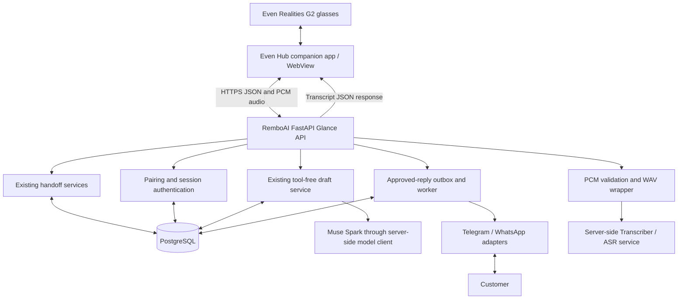

# RemboAI Glance — End-to-End Workflow (v6)

**Project:** RemboAI Glance  
**Purpose:** Bring RemboAI's owner escalation workflow to Even Realities G2 smart glasses.  
**Document status:** Implementation workflow and build plan. v6 incorporates two review passes over v5, resolves the identified contract and sequencing inconsistencies, and updates the feature-request treatment against the public Even Hub issue tracker.  
**Last updated:** 23 November 2026  
**Competition build window:** 23 November 2026, 12:00 Dubai time (11:00 UTC+3) through 29 November 2026, 23:59 Dubai time (22:59 UTC+3), according to the organizer schedule. Submission opens at kickoff and closes at the stated deadline.

> **Core product idea:** RemboAI already handles customer conversations and business workflows. RemboAI Glance gives the salon/barbershop owner a glanceable, voice-assisted, minimal-touch way to inspect conversations that need human attention, prepare a response, correct it by voice, explicitly approve it, and send it through the customer's existing channel.

This document describes the architecture and work from the current state through implementation, testing, deployment, demonstration, and submission. It distinguishes existing RemboAI capabilities from Glance functionality that still needs to be built.

**Precedence:** §0 (competition fit and priorities), §7 (API contract and conventions) and §18 (design decisions) are normative. If any other section appears to conflict with them, follow those sections and correct the other section.

### What changed in v6

- **Case-version semantics:** case `version` increments for customer-visible customer events, approved owner-reply events, and the open-to-resolved transition. Outbox delivery-state transitions and internal audit events by themselves do not increment it. Resolve increments the version exactly once.
- **Idempotency scope:** keys are scoped by salon, HTTP method, canonical route including concrete case/draft IDs, and key value. Draft/revision replay records live 24 hours; a reply's idempotency identity is retained with its outbox audit record for that record's retention lifetime.
- **Outbound concurrency:** the MVP permits at most one unresolved outbound reply (`queued`, `sending` or `unknown`) per case. This makes `latest_reply` sufficient for the active reply and prevents an older ambiguous send being hidden by a newer reply. Legacy invariant violations fail closed.
- **Session revocation:** current-session revocation and owner-channel device/session revocation move to P0. A lost device can be revoked without access to that device; no multi-device management UI is required.
- **Context pagination signal:** Glance retrieves eleven eligible visible events, returns the latest ten in ascending order, and uses the extra event to calculate `has_earlier`. The existing ten-event service behavior must not be assumed to provide this flag.
- **Grounding claims:** a natural-language model instruction is not treated as a deterministic contradiction detector. Structured authoritative facts take precedence; deterministic conflicts are rejected where they can be checked reliably, and uncertain claims must be made cautiously for owner review.
- **Feature requests:** secure-storage/authentication work is cross-referenced to existing Even Hub issue #25 rather than presented as a duplicate new request. Two genuinely new requests remain drafted; two slots are reserved for issues actually encountered during the build. Existing issue #25 is supporting context, not a third request.
- **Kickoff-day wording and gates:** pre-kickoff actions are now historical verification items; unresolved staging, SDK and code-contract decisions are explicitly treated as kickoff gates rather than assumed complete.

### What changed in v5

- **API contract (§7):** added §7.0 conventions (envelope, headers, idempotency rules, text limits, enumerations, logging). Inbox gains `open_count`/`has_more` and a defined sort order. Case detail and status gain `latest_reply` so the app can recover after a restart or a lost 202. Resolve returns `cancelled_reply_ids` and has a defined order of checks and an idempotent repeat. Draft generation has a 12-second deadline (`draft_timeout`). Added an error-code registry (§7.11). Removed the model identifier from draft responses and fixed the stale example timestamps and session-lifetime wording.
- **Version rule (§6.9, §7.8):** outbox state changes must not bump the case `version`; verification item added (§17, D-2).
- **Even Hub documentation findings (§5, §6.3, §6.7, §8.3, §9, §10, §11, §13, §14):** plugins are foreground-only; microphone permission must be declared in `app.json`; audio format is documented; the session token lives in `localStorage` (no secure vault is documented); polling pauses and resumes on the SDK foreground events; long press is not used; there is no programmatic scroll.
- **Feature requests (§0.7):** three requests drafted in the what/found/workaround/fix format, two slots reserved for things hit during the build, two dropped with reasons.
- **Open decisions D-1 to D-5 (§0.6)** for the items that need the real code to settle.
- **Tests and acceptance (§14):** new checks for each of the above.


### What changed in v4

- Added §0: track choice, judging map, rules compliance, submission checklist, priority tiers and items to resolve before kickoff.
- Resolved contradictions about `unknown` replies: resolution returns 409 (`unknown_reply_requires_acknowledgement`) unless the owner explicitly acknowledges; `sending` returns 409 (`reply_still_sending`). §7.11, §17 and §18 now agree with §6.10 and §7.10.
- Pairing codes are HMAC-hashed with per-source and per-owner limits everywhere (§7.1, §18). No global lockout.
- Rewrote §13 as a P0/P1/P2 build plan with explicit cut lines and a safe fallback if the Telegram `/resolve` change slips.
- Rewrote §16 as a 3-minute demo built around one-tap approval and a short spoken instruction.
- Removed the "pre-prepared fixture" demo fallback. A recorded backup must be disclosed as a recording.
- Fixed duplicate §18 numbering (the demo-day checklist is now §21) and froze the session lifetime at 7 days.
- Added the ASR warm-up operation and Telegram two-step unknown confirmation to §2.3.

---

## 0. Competition fit, priorities and submission

### 0.1 Entry

- **Event:** Heads Up: Even Realities Hackathon (TVM Ventures & Daos Hub, hosted on DoraHacks).
- **Track:** 01 · Messaging & News. Telegram is the integrated listed app (customer channel and owner pairing).
- **Special prize:** Best Telegram integration is open to any track. A project can win only one cash prize, so decide which to emphasize at submission; it does not change the build.
- **Team:** solo (teams of 1–4 allowed).
- **Dates:** kickoff and build start 23 Nov 12:00 Dubai (11:00 EAT); deadline 29 Nov 23:59 Dubai (22:59 EAT); judging 30 Nov – 1 Dec; Demo Day 3 Dec (finalists may demo remotely).
- **Internal target:** submit by 29 Nov 12:00 EAT, leaving about ten hours of buffer.

### 0.2 Judging map

| Criterion | Weight | How Glance addresses it | Plan consequence |
|---|---:|---|---|
| Usefulness on G2 | 30% | A salon owner with busy hands sees only conversations that need a human, one case at a time | Inbox shows escalations only; one thing per screen; demo opens with the hands-busy moment |
| Read & write | 25% | AI drafts the reply; owner approves in one tap/ring press; a short spoken instruction adjusts it | P0: one-tap approval path and voice instruction; avoid long dictation as the main path |
| Technical execution | 20% | Real backend, idempotent approval, truthful delivery status, tenant isolation, regression suite | P0 loop reliability; regression gate in §14.8 |
| UX for display and voice | 15% | 576 × 288 monochrome, few words, explicit mode choice after transcription | Copy from `docs/glance.md`; test on simulator and hardware if available |
| Business potential and safety | 10% | Owner approves exact text; AI has no tools; no payment claims; synthetic data in demo | §11 and §16; real-user quote from the barbershop owner if available |

### 0.3 Rules compliance

- [ ] README states what existed before 23 Nov (summary in the README itself, details in `PRIOR_WORK.md`).
- [ ] Ask once in the hackathon chat whether the author's own existing backend (RemboAI) is acceptable as pre-existing infrastructure for a track-1 Telegram project. Record the answer in `PRIOR_WORK.md`.
- [ ] Only listed apps in the track are used (Telegram). WhatsApp is not shown in the submission.
- [ ] No secrets in either repository; `app.json` contains the public API host and required permission declarations only, never credentials or secret values.
- [ ] Only synthetic customers, messages and names appear in the video and screenshots (privacy of people whose messages are shown).
- [ ] No code for the competition is committed to `remboai-glance` before kickoff. The 22 Nov spike is throwaway and is not submitted.

### 0.4 Submission checklist

- [ ] Public repository with a README that explains setup (backend base URL, how to run the simulator, how to pair).
- [ ] Demo video of at most 3 minutes (simulator or glasses), cut per §16.
- [ ] Short description: problem, who it is for, how it works, track.
- [ ] Submit up to 5 evidence-backed feature requests: two new requests are drafted, two slots are reserved for issues actually encountered during the build, and existing issue #25 is referenced rather than duplicated.
- [ ] Optional: packaged `.ehpk` build.
- [ ] "How did you hear about this hackathon?" answered.
- [ ] Final commit SHA, video link and repo link recorded.

### 0.5 Priority tiers

Every day ends with the P0 loop working. A P1 item starts only after that day's P0 exit criteria pass.

| Tier | Meaning | Items |
|---|---|---|
| **P0** | Needed for the 3-minute demo | Pairing by short code; sessions; current-session and owner-channel session/device revocation; inbox (limit 20, no cursor) with 5 s polling; case detail; AI draft; manual draft; phone-side editor; approve and queue reply; reply status; one-unresolved-reply-per-case invariant; resolve with shared resolver (queued cancel, `sending` 409, `unknown` acknowledgement, Telegram safe default); Caddy route, CORS, `app.json` whitelist; transcription with 15 s deadline; spoken instruction that revises the AI draft (grounded on the owner's fact); ASR warm-up operation; 3-minute video; README and submission |
| **P1** | Raises the score if time allows | Mode A (dictate the exact reply); case status endpoint for 5–10 s case polling; dedicated per-session quotas for draft/revise and ASR (P0 keeps the read quota and a basic transcription limit); worker readiness signal; additional ring-event polish; physical hardware test; Telegram two-step unknown confirmation (the safe default below is P0) |
| **P2** | Defer | Cursor pagination; WhatsApp; iOS WebView testing; async ASR jobs; ETag/304; multi-device management UI |

**Safe default if Telegram `/resolve` work slips:** Telegram `/resolve` must refuse to resolve a case that has an `unknown` reply and tell the owner to use Glance (or the later two-step confirmation). It must never silently acknowledge an ambiguous send.

### 0.6 Frozen decisions and kickoff-day gates

Frozen for the MVP:

- Session lifetime: **7 days**, configurable by environment variable and revocable.
- Demo channel: Telegram only.
- Demo scenario: human-requested salon-policy question (§16).
- Voice: after transcription the owner explicitly chooses reply or instruction; instruction is the demo path.
- No background push/wake behavior is assumed; inbox polling runs only while the app is foregrounded.
- One unresolved outbound reply (`queued`, `sending` or `unknown`) is allowed per case at a time.

**Kickoff-day gates — verify before relying on them:**

- **Staging hostname and isolation.** Select a hostname pointing to an isolated staging stack with its own database and Redis and synthetic data. The production host and live customer data are not the default development target. If isolated staging cannot be prepared immediately, keep the Glance route disabled from public use until staging isolation is in place.
- **SDK/runtime checks.** Record the pinned SDK/template version and verify the exact `app.json` network and microphone permission schema, the packaged WebView `Origin` and preflight behavior, phone-side editable text input (keyboard, paste, multiline and Unicode), actual microphone capture, tap/ring event behavior, and Modal cold/warm latency. Simulator rendering and input-event success do not prove these phone/WebView or hardware behaviors.
- **Competition eligibility.** Ask in the hackathon chat whether the existing RemboAI backend is acceptable as pre-existing infrastructure for a Track 01 Telegram project; record the answer in `PRIOR_WORK.md`.
- **Prior-work disclosure.** Verify the current local and remote commit SHAs, identify all pre-kickoff backend work, and disclose it accurately. Do not claim the reported 880-test result has been rerun on the current checkout unless it has.

**Open API decisions — settle against source code before the relevant endpoint is implemented:**

- **D-1:** Can `approve_reply()` take inline owner text without a prior draft row? If yes, decide whether `/drafts/manual` remains necessary for Glance provenance and audit; do not remove it solely to save one route if that loses durable authoring provenance. [Default: keep the endpoint until signatures and audit semantics are inspected.]
- **D-2:** Verify the actual case-version behavior in `handoff_outbox.py` and `handoffs.py`. The v6 rule is: customer-visible customer events, approved owner-reply events, and the open-to-resolved transition increment the case `version`; outbox state transitions and internal audit events by themselves do not. Resolution increments once for the state transition, including its internal audit event. [Default: change implementation only after confirming actual behavior and adding focused tests.]
- **D-3:** Does the existing `Transcriber` accept a language hint? The audience mixes Swahili, Sheng and English. [Default: no hint, auto-detect.]
- **D-4:** Confirm the text limits and enumerations in §7.0 against current service/provider limits. Confirm draft idempotency retention and reply-key retention follow the separate rules in §7.0. [Default: as written.]
- **D-5:** Check the contract against the real signatures of `list_open_handoffs`, `get_handoff_context`, `generate_draft`, `approve_reply` and `resolve_handoff`, and the handoff, event, draft and outbox tables in migrations 044–046. Also verify that a Glance-specific context query can fetch an eleventh eligible event without changing other callers' existing ten-event behavior. [Default: unverified until inspected.]

---

### 0.7 Feature requests (draft wording)

The organizers pass these to the teams behind the APIs, so each new request should say what was needed, what the documentation says, what was done instead, and what change would fix it. Submit only requests encountered while building Glance, with a doc link or a simulator/hardware observation behind each. Two new requests are drafted below; two slots remain reserved. The secure-authentication item is cross-referenced to an existing public issue and is not counted as a new request.

**1. Even Hub: background push or wake events**

- *Needed:* tell a salon owner that a customer case needs a human while another app is on the glasses or the display is off.
- *Found:* the Even Hub FAQ states "Plugins are foreground-only on the glasses" and that the WebView is suspended in the background so in-flight requests stall. No push or wake event reaches a plugin.
- *Workaround:* Glance polls every 5 seconds while it is on screen; a new case appears only on the next poll or when the app is opened. Any alert has to come from outside the glasses (a Telegram message to the owner's phone).
- *Requested:* a documented, permissioned wake or push event, or a short notification slot on the display, that a plugin's own backend can trigger with a small payload.

**2. Telegram Bot API: delivery or read confirmation**

- *Needed:* tell the owner whether an approved reply reached the customer.
- *Found:* `sendMessage` returns the sent `Message` on successful submission, but the Bot API provides no delivery or read confirmation event for a bot message in a private chat. Cite the current official Bot API reference when submitting this request.
- *Workaround:* Glance shows "Sent to Telegram (delivery not confirmed)" and stores `delivery: unsupported`. It never claims "delivered".
- *Requested:* an opt-in delivery or read event, or a status field, for messages a bot sends to users who have started it.

**3. Existing Even Hub issue to reference — do not submit as a duplicate**

- The public tracker already has [issue #25](https://github.com/even-realities/everything-evenhub/issues/25), requesting native system-browser authentication and credentialed networking for WebAuthn/enterprise SSO. This is related to the broader authentication gap, but it should not be represented as proof that a Keychain/Keystore-backed generic secret vault exists or is already delivered.
- *Our need:* retain a revocable 7-day Glance session without relying on storage whose OS-backed at-rest protections are undocumented.
- *Current workaround:* the documented WebView `localStorage` with a bounded 7-day, server-revocable session, never logged or placed in URLs, cleared on 401/403.
- *Action:* reference/support issue #25 and ask maintainers whether its scope includes an OS-backed app credential store. Do not file a duplicate generic secure-auth request. Only submit a separate, narrowly scoped secure-storage request if maintainers confirm that Keychain/Keystore-backed token storage is outside #25.

**4 and 5. Reserved.** Fill these only from something hit during Days 1–5. Current candidates, to keep only if the build confirms them:

- The `Origin` the packaged WebView sends is undocumented, `null` or unstable, which forces a wildcard-origin CORS fallback instead of an exact allowlist.
- The phone-side editable text field is missing, unreliable (paste, multiline, Unicode) or undocumented.
- Anything met with microphone capture, ring events or foreground events during Days 2–4.

**Dropped, with reasons**

- *Long-press ownership:* Glance does not use long press, and the FAQ already documents that the OS claims tap-then-long-press for its own menu. Re-add only if a real conflict is observed.
- *Scroll auto-follow:* accurate (the docs list "no programmatic scroll position" as unsupported) but an existing request already covers it. Re-add only with a new angle from a screen that needed it.

Sources: [Even Hub FAQ](https://hub.evenrealities.com/docs/reference/faq), [Device APIs](https://hub.evenrealities.com/docs/build/device-apis), [Contextual menu](https://hub.evenrealities.com/docs/build/contextual-menu).


## 1. Executive summary

RemboAI Glance is not a second chatbot and is not a replacement for RemboAI. It is a new G2 client for a narrow set of owner actions.

The system has two repositories and one runtime API boundary:

1. **`remboai`** — the existing Python/FastAPI backend. It remains the source of truth for salons, customers, bookings, payments, handoffs, AI generation, speech transcription, and outbound messages. It will expose a small authenticated Glance API.
2. **`remboai-glance`** — the new Even Hub/G2 application. It owns the G2 screen experience, touch/microphone interactions, pairing UI, API client, local presentation state, and demo assets.
3. **HTTPS REST API** — the two repositories communicate at runtime through the RemboAI server. They do not import each other's source code, share a runtime database connection, or communicate through Git.

Planned public API base URL:

```text
https://remboai.duckdns.org/api/v1/glance
```

This URL is a **planned API base**, not a currently implemented or verified Glance endpoint. The latest audit found no Glance routes, pairing/session implementation, CORS configuration, or Caddy routing for this path.

The G2 application must never connect directly to PostgreSQL or carry database credentials, Muse Spark credentials, ASR credentials, Telegram tokens, WhatsApp tokens, or the RemboAI operations key.

### MVP success condition

A salon owner pairs the G2 app, sees a real open customer escalation, reads a safe summary, generates an AI draft, dictates or edits a correction, explicitly approves the final text, sees the backend queue and submit the reply through Telegram, and separately resolves the case when the issue has actually been handled.

The payment itself remains governed by the existing payment workflow. Sending a reply or resolving a handoff must never mark a payment as received, verified, refunded, or settled.

---

## 2. Current state: what exists and what does not

### 2.1 Latest backend baseline

The latest audited local backend baseline is:

```text
Repository: /home/sam/Desktop/remboai
Branch:     main
HEAD:       e2e67cb7649edf80cfaea540f3e59b53cec552d6
Parent:     d8085438d0479a1d874faecd06deb82f043affc6
Migrations: 044–046 present; migration directory reaches 046
```

The `e2e67cb` response-quality change followed the corrected outbox baseline `d808543`. Existing backend code, migrations 044–046, the handoff/outbox/draft services, PCM utility, response-quality work, and their pre-kickoff tests are prior work and must be disclosed in `PRIOR_WORK.md`/the README; they are not to be represented as built during the hackathon. At the last compatibility audit, `origin/main` was still at `da45dd37eac75534a523c70b9aae8dcd9adde8cd`, six commits behind the local checkout. This is a historical observation from that audit; verify the current remote state before pushing.

The last reported full Docker test suite for the response-quality change was **880 passed**, in **755.45 seconds**, exit code 0. The response-quality evaluator passed 186/186 static checks and the response-quality tests passed 193 checks. These results are reported test evidence, not a claim that the suite has been rerun since this document was written.

The compatibility audit reported one untracked item:

```text
?? docs/glance.md
```

Preserve this file. It contains proposed owner-facing G2 display copy and should be reviewed and carried into `remboai-glance` as a design asset, rather than accidentally discarded during cleanup.

### 2.2 Implemented in the RemboAI backend

The following business services exist in the audited checkout and should be reused rather than reimplemented:

| Capability | Current implementation state | Relevant implementation |
|---|---|---|
| Durable handoff creation | Implemented | `app/handoffs.py`, called by handoff guard flow |
| Explicit handoff resolution | Implemented | `resolve_handoff()` in `app/handoffs.py` |
| Owner/salon checks in services | Implemented for existing owner flows | `app/handoffs.py`, `app/owner.py` |
| Case timeline with visibility | Implemented | Migration 044 and handoff event service |
| Customer-visible context retrieval | Implemented, bounded to ten visible messages | `get_handoff_context()` in `app/handoffs.py`; Glance needs a compatible 11-event look-ahead to compute `has_earlier` without changing other callers |
| Open handoff inbox query | Implemented as a service, not HTTP API | `list_open_handoffs()` in `app/handoffs.py` |
| Versioned handoff state | Implemented | Handoff version/event sequence from migrations 044–046 |
| Tool-free, case-bound AI draft | Implemented as a service, not HTTP API | `generate_draft()` in `app/handoff_drafts.py` |
| Exact owner-approved reply persistence | Implemented as a service | `approve_reply()` in `app/handoff_outbox.py` |
| Durable outbound outbox | Implemented | Migration 045 and `app/handoff_outbox.py` |
| Structured Telegram/WhatsApp outcomes | Implemented | `app/channels/results.py` and channel adapters |
| Outbox worker | Implemented in app lifecycle | FastAPI lifespan in `app/main.py` |
| PCM-to-WAV utility | Implemented as a utility | `app/ai/audio.py` |
| Customer response quality improvements | Implemented in local commit | `app/messages.py`, `app/guard.py`, `app/agent/prompt.py` and related tests |
| Synthetic response quality corpus | Implemented | `response_quality_corpus.py`, `response_quality_eval.py` and tests |

Important business guarantees already introduced:

- An open handoff is not automatically resolved by the old conversation timeout.
- Handoff creation, initial event and paused conversation state are committed transactionally.
- Owner notification occurs after the case transaction commits.
- Owner-only notifications are not exposed as customer-visible case messages.
- Diagnostic conversation traces are not used as Glance conversation context.
- New customer events update the case version, so stale drafts can be rejected.
- Draft generation uses one model step with an empty tool list; it does not run the ordinary tool-executing agent loop.
- Approval stores the exact edited/approved message and outbox record before dispatch.
- Only queued outbox records are dispatched. Ambiguous outcomes and expired `sending` leases become `unknown` and are not automatically resent.
- Accepted Telegram/WhatsApp submissions remain `submitted` unless an actual provider receipt updates delivery state. Telegram does not have a delivery receipt in this implementation.
- Handoff resolution does not settle or change payment records.

### 2.3 Missing Glance integration functionality

The following items were not implemented at the last compatibility audit:

| Missing item | Why required |
|---|---|
| Pairing-code generation from verified owner channel | Initiates trusted device pairing |
| Pairing exchange endpoint | Exchanges one-time code for a Glance session |
| Glance session table, token hashing, expiry and revocation | Authenticates the G2 app independently of the owner's chat session; must support current-session and owner-channel device/session revocation in P0 |
| Glance API router | Exposes the existing backend services over HTTP |
| Owner-scoped reply-status endpoint | Lets G2 poll the outbox result safely |
| Manual owner-authored draft endpoint | Persists typed or directly dictated text with a draft ID before approval |
| Draft-revision endpoint | Applies a spoken/typed owner instruction to an existing AI draft, with instruction provenance |
| Glance-specific context look-ahead (`limit=11`, return latest 10) | Calculates `has_earlier` without changing the existing service contract for other callers |
| Case status/version endpoint | Supports lightweight 5–10 second active-case polling |
| CORS middleware/configuration | Allows the Even Hub WebView to make authenticated cross-origin requests |
| Caddy route for `/api/v1/glance/*` | Sends the API path to FastAPI rather than the static site handler |
| Route-specific audio body limit | Current app and Caddy limits are 256 KiB, smaller than G2 PCM payloads |
| Audio transcription HTTP endpoint | Connects the PCM utility to the existing ASR client |
| 30-minute Glance draft policy | Extends/configures the internal ten-minute draft expiry for Glance; must be implemented and tested |
| Shared resolver / Telegram `/resolve` update | Adds version-safe Glance resolution and explicit unknown-send acknowledgement to the existing Telegram owner command; requires full RemboAI regression testing |
| Explicit unknown-reply resolution acknowledgement | Lets an owner accept responsibility for an ambiguous send without retrying it |
| Session-aware approval audit | Records which paired Glance session approved a reply; retain attribution after session revocation/deletion |
| Route-specific audio timeout policy | Current Caddy response timeout is shorter than the configured ASR client timeout |
| Per-session pairing/draft/ASR rate limits | Existing ingress limits are not Glance session limits |
| Draft/revision idempotency | Retries can create more than one draft record/model call |
| Worker heartbeat/readiness signal | `/ready` currently checks the database, not outbox worker health |
| HTTP/API integration tests | Existing tests primarily prove service behavior, not the new WebView/API boundary |
| Protected ASR warm-up operation | Lets the owner warm the Modal worker before a demo without a public route or customer audio |
| Two-step Telegram confirmation for an `unknown` reply (P1) | Until it exists, Telegram `/resolve` must refuse to resolve a case that has an `unknown` reply |
| Pairing HMAC secret with key version | Keeps the 60-bit pairing code from being brute-forced offline after a database leak |
| One-unresolved-reply-per-case enforcement | Prevents an older `unknown` reply from being hidden by a newer `latest_reply`; enforce under the case lock and at the database layer where supported |

**Do not describe any missing route or pairing capability as already working.** The services are reusable, but they are not a security boundary until exposed through authenticated routes.

---

## 3. Product scope and non-goals

### 3.1 The product

**RemboAI Glance: the human escalation console for busy salon and barbershop owners.**

RemboAI handles routine customer conversations. When a conversation needs a person, RemboAI creates a durable handoff. Glance brings the case to the owner on the G2 display and lets the owner decide what happens next.

### 3.2 MVP capabilities

The first end-to-end version needs only:

1. Pair the G2 application to a verified owner and selected salon.
2. Retrieve a compact list of open cases.
3. Open a case and read bounded, customer-visible context.
4. Generate a draft using the existing tool-free draft service.
5. Capture a short voice correction and display its transcription.
6. Let the owner edit and explicitly approve the exact final message.
7. Queue and dispatch the reply through the customer's original channel.
8. Show truthful reply status.
9. Let the owner explicitly resolve the handoff independently of payment state.

### 3.3 Deliberately out of scope for the first demo

- A second chatbot or a replacement for the RemboAI agent.
- Direct G2 access to PostgreSQL.
- Direct G2 calls to Muse Spark, Modal ASR, Telegram or WhatsApp APIs.
- Putting database/provider/operations credentials into the G2 package.
- Arbitrary phone notification mirroring or background pop-ups when the Even app is not active.
- General-purpose analytics dashboards.
- Full historical conversation archive migration.
- Multi-owner/staff permission system.
- Merging the same human's Telegram and WhatsApp identities.
- Full attachment/image storage and display.
- Automatic AI case resolution, refunds, payment settlement or booking confirmation.
- WebSockets or a separate microservice architecture for the MVP.

The recommended demo channel is Telegram first. The backend retains its WhatsApp capability, but the first complete G2 workflow should use one fully tested channel to reduce integration risk.

---

## 4. Architecture and repository responsibilities

### 4.1 Runtime architecture



The diagram is conceptual. The existing FastAPI application, database pool and worker remain part of one RemboAI deployment. Muse Spark and ASR remain provider integrations behind the server. Do not split them into new services just for Glance.

### 4.2 Repository 1: `remboai`

Responsibilities:

- Existing customer-facing business logic.
- Salon/customer identity and authorization source of truth.
- Handoff state, event timeline and case versions.
- AI draft generation and grounding.
- Approved-message persistence and outbox dispatch.
- Telegram/WhatsApp delivery adapters.
- ASR client and audio preprocessing.
- New Glance pairing/session and HTTP/API layer.
- CORS, Caddy routing, rate limits, API logging and readiness.

Expected new modules/routes (names can be adjusted to repository conventions, but keep the boundary narrow):

```text
app/
  glance_api.py          # HTTP routes, request/response validation
  glance_sessions.py    # pairing codes, session validation/revocation
  handoffs.py            # existing case service; extend only where necessary
  handoff_drafts.py      # existing draft service
  handoff_outbox.py      # existing approval/dispatch service
  ai/audio.py            # existing PCM/WAV utility
  main.py                # router and lifespan wiring
  hardening.py           # route-specific request size policy

deploy/
  Caddyfile              # explicit Glance API proxy and route-specific limits/timeouts
  docker-compose.prod.yml
```

Do not duplicate the business rules in the route handlers. A route authenticates, validates, calls a service and serializes the result.

### 4.3 Repository 2: `remboai-glance`

Responsibilities:

- Even Hub SDK application and packaging.
- G2 screen layouts and navigation.
- Pairing UI and secure session handling within the app runtime.
- Typed HTTP API client.
- Inbox and case view presentation.
- Voice capture and transcript review.
- Explicit approval interaction.
- Connection/loading/error state.
- Demo configuration, synthetic data instructions, pitch and recording assets.

Suggested structure:

```text
remboai-glance/
  app.json
  package.json
  src/
    main.ts
    api/
      client.ts
      types.ts
      errors.ts
    auth/
      pairing.ts
      session.ts
    screens/
      inbox.ts
      case-detail.ts
      draft-review.ts
      voice-capture.ts
      reply-status.ts
    state/
      app-state.ts
      connection-state.ts
    ui/
      display-copy.ts
      layout.ts
  tests/
    api-contract/
    state/
    interaction/
  docs/
    WORKFLOW.md
    API_CONTRACT.md
    PRIOR_WORK.md
    DEMO_SCRIPT.md
  README.md
```

This is a suggested organization, not a requirement to create every file. Keep the app small and aligned with the official Even Hub template.

### 4.4 How the repositories communicate

They communicate only through the HTTPS API at runtime:

```text
remboai-glance (Even Hub WebView)
       |
       | HTTPS requests + Authorization: Bearer <session>
       v
https://remboai.duckdns.org/api/v1/glance
       |
       v
remboai FastAPI application
       |
       v
existing handoff / draft / outbox / ASR services
       |
       v
PostgreSQL and external providers
```

No direct source imports, submodule, shared local files, database socket, or GitHub API call is involved in runtime communication.

The backend OpenAPI schema and the versioned API contract should be the interface source of truth. The Glance repository should define matching TypeScript types or generate them from the backend OpenAPI document when convenient.

### 4.5 URLs and secrets

Confirmed intended public host:

```text
https://remboai.duckdns.org
```

Planned Glance API base:

```text
https://remboai.duckdns.org/api/v1/glance
```

The planned path is not yet routed or implemented. The latest audit found Caddy sends that path to the static site handler until an explicit proxy route is added.

Only the API hostname should be present in the Glance network permission whitelist. No credentials or secret values belong in `app.json`.

The backend has its own private `DATABASE_URL`, model credentials, ASR credentials, Telegram token, and operations key. These stay server-side. Glance uses only a time-limited, revocable Glance session token returned after pairing.

For safe development, prefer an isolated staging deployment and hostname. The exact staging hostname has not been selected. Do not point the first G2 integration at live customer data. If a separate hostname is unavailable, use an isolated staging deployment and routing configuration before enabling the Glance paths on the existing public host.

---

## 5. Hardware and interaction assumptions

The workflow is designed around the G2 display and microphone, not a phone-sized interface.

Planning assumptions from the existing technical investigation:

- Monochrome green display, approximately 576 × 288 pixels.
- Microphone input available through the Even Hub application.
- Touch/event-driven navigation.
- No onboard camera or speaker assumed for this workflow.
- The paired phone/WebView performs network requests.
- The application should not assume it remains continuously active in the background.
- Plugins are **foreground-only**: the WebView is suspended in the background and in-flight requests stall. There are no push or wake events, so Glance cannot alert the owner to a new case while it is not on screen (Even Hub FAQ).
- Audio: the SDK delivers PCM 16 kHz, signed 16-bit little-endian, mono from either the glasses microphone (default) or the phone microphone. Capture fires only while `audioControl(true)` is held and the microphone permission is granted.
- Input: click and double-click from the glasses and the R1 ring (distinguishable by source), plus scroll-boundary events. Only one container per page captures events. Long press exists (SDK 0.0.14+, Even App 2.2.9+) but the OS claims tap-then-long-press for its own menu, so Glance does not depend on it.
- There is no programmatic scroll position. Page long text in fixed-size chunks instead of relying on scrolling.
- Storage: `localStorage` survives suspension, kill and update, is cleared on uninstall and is sandboxed per `package_id`. No secure credential store is documented.

The official SDK/template and actual simulator must be checked at kickoff for the exact pinned SDK behavior. In particular:

- Parse the full event envelope before interpreting an input.
- Do not treat an omitted event type as a click unless the SDK contract and envelope establish that interpretation.
- Distinguish click/double-click/touch events from audio frames.
- Keep interactive UI state in the app; do not rely on a persistent socket or uninterrupted WebView process.
- Re-fetch authoritative state after app resume or reconnect.

### Display policy

The glasses display is for short, high-priority information, not a full chat transcript.

Suggested content limits:

- Inbox item: category, short customer label, channel, short preview, age and current status.
- Case prompt: one issue summary and a maximum of ten bounded context messages returned by the server.
- Individual G2 prompt/summary: aim for about 200 characters or less where practical.
- No raw phone number, payment evidence, internal notes or diagnostic traces on the glasses.
- Full context, if needed, can be shown in the companion WebView; it is not necessary for the first demo.

Keep customer-facing message text separate from Glance's internal owner-facing display copy. `docs/glance.md` is the current proposed copy reference; preserve and review it.

---

## 6. End-to-end business workflow

This section defines the canonical user journey from customer message through owner resolution.

### 6.1 Customer creates a situation needing human attention

1. A customer sends a message to the existing RemboAI Telegram bot. WhatsApp remains supported by the backend, but Telegram is the first demo channel.
2. The existing authenticated inbound webhook accepts and queues the event.
3. The RemboAI inbound worker processes the message using existing conversation logic.
4. The guard/rule/agent logic determines that human intervention is required, for example a payment dispute, complaint, sensitive request or explicit human request.
5. `create_handoff()` persists the handoff, initial event, case version/event sequence and paused conversation state in one database transaction.
6. If persistence fails, the system must not tell the customer that an owner has been notified and must not create an inconsistent paused state.
7. After the transaction commits, RemboAI attempts to notify the owner through the existing owner channel.
8. The owner notification is an internal event, not a customer-visible reply.
9. The open handoff is the durable source of truth. Owner notification delivery is not the source of truth.

### 6.2 Further customer messages arrive while a case is open

1. The inbound message is deduplicated using the provider event/message identity.
2. The message is appended to the same open case timeline as a `customer_visible` customer event.
3. The case version increments atomically with the event insert.
4. Existing drafts based on an older version become stale.
5. The case remains open until an authorized owner explicitly resolves it.
6. The old timeout must not silently change the case status to `resolved`.

### 6.3 Owner pairs the G2 app

The owner performs code entry on the **paired phone's Even Hub WebView**, not on the glasses. The G2 is not assumed to have a keyboard or camera. The MVP does not depend on QR scanning or undocumented deep-link behavior.

1. The owner starts pairing from an already authenticated owner channel, initially Telegram.
2. If the same owner has multiple salons, the bot presents the eligible salon selection. The owner selects the salon to pair.
3. The backend verifies the sender against the selected salon's current `owner_wa_id`.
4. The backend generates a cryptographically random, human-typeable **12-character Crockford Base32 code** (60 bits of entropy). This is a short-lived pairing challenge, not a reusable password or session token.
5. Store only `HMAC-SHA-256(pairing_hmac_secret, normalized_code)` in the database. Do not use an unkeyed hash: a 60-bit human-entered code is small enough for offline enumeration after a database leak. Keep the HMAC secret outside the database in the server secret manager/environment, support secret rotation with a key-version field, and compare digests in constant time. The code is bound to owner identity and salon ID, expires after five minutes, and is single-use.
6. The bot sends the code privately to the owner in Telegram. The owner copies/pastes or types it into a pairing field in the phone's Even Hub WebView. No input is required on the glasses themselves.
7. Glance sends `POST /pairing/exchange` over HTTPS with the code and a device label. It does not send a salon ID or owner identity as authority.
8. The backend atomically consumes the code and creates a session.
9. The backend returns an opaque access token, expiry and safe salon label. Store only the token hash server-side.
10. Glance stores the token in the WebView's `localStorage`, which survives suspension, kill and update, is sandboxed per `package_id` and is cleared on uninstall. No secure credential store is documented, so the token is treated as a revocable, expiring bearer secret: 7-day expiry, server-side revocation, never logged, never placed in a URL, and cleared on a 401 or 403. The owner is not asked to re-pair on every restart. This is a documented platform limitation/workaround, not a claim that `localStorage` is protected by Keychain or Keystore; the related existing issue is referenced in §0.7.
11. A lost pairing-exchange response should require a new pairing code unless a deliberate, securely designed recovery mechanism is implemented.
12. Every authenticated request checks session expiry/revocation and revalidates that the bound owner still owns the bound salon.

Pairing-code security controls:

- Use 12 randomly generated Crockford Base32 characters; do not make a 128-bit secret manually typeable.
- Five-minute expiry and atomic single use.
- Strict online guessing controls: apply independent limits per source/IP and per owner identity, plus a broad abuse/anomaly ceiling. Do not let a global failed-attempt counter lock out every legitimate owner. Apply a short cooldown to the offending source and/or owner after repeated failures. Return the same public error for unknown, expired and used codes.
- Store no plaintext code in the database or logs.
- The resulting bearer session token is independently high entropy (at least 128 bits), opaque, hashed at rest, expiring and revocable.
- QR/deep-link pairing can be considered later only if the pinned Even Hub runtime provides a verified handoff mechanism. It is not required for the MVP.
- Session lifetime is **7 days**, configurable by environment variable and revocable (frozen in v4, §0.6).
- Owner must have a way to revoke a device/session through the owner channel; session self-revocation should also exist in the API.

### 6.4 Owner opens the inbox

1. Glance calls `GET /inbox?limit=20` with the session bearer token.
2. The backend obtains salon and owner identity from the validated session.
3. The backend calls the existing owner-scoped `list_open_handoffs()` service; it does not trust caller-supplied salon IDs.
4. The inbox query returns only open cases belonging to the bound salon.
5. The response uses short labels and compact previews; no full phone numbers or internal events.
6. Glance displays the list in a compact G2 layout.
7. The MVP returns at most 20 open cases; cursor pagination is deferred (P2).
8. When the app resumes or reconnects, Glance re-fetches the authoritative inbox instead of assuming its cached list is current.

### 6.5 Owner opens a case

1. The owner selects an inbox item.
2. Glance calls `GET /cases/{case_id}`.
3. The backend performs a salon-scoped lookup using the session salon and case ID.
4. A case belonging to another salon returns 404; the response must not reveal whether the ID exists elsewhere.
5. The backend uses `get_handoff_context()` and returns up to ten ordered `customer_visible` events.
6. Internal notifications, internal notes and diagnostic trace rows are never included.
7. The response includes case ID, current version, status, category, channel, short customer label and bounded context.
8. Glance displays a compact summary and lets the owner open relevant messages without exposing unnecessary personal data.

### 6.6 Owner requests an AI draft

1. Glance sends the case ID and `expected_version` to `POST /cases/{case_id}/drafts`.
2. The backend authenticates the session and checks ownership of the salon and case.
3. The backend retrieves the allowlisted case context and facts.
4. The existing draft service invokes `AgentModel.step()` with an empty tool list.
5. Any model output attempting to call a tool is rejected. Do not call the ordinary `agent.drive()` loop.
6. The draft prompt instructs the model not to invent prices, booking status, payment verification, refunds, owner actions or other facts. For a revision, the authenticated owner's explicit instruction is a separately labelled, attributable source for business policy/context; it may supply facts absent from customer history, but cannot override authoritative database state or silently create a payment/booking fact.
7. The generated text is grounded against the available case facts.
8. The backend rechecks the case version after model inference.
9. If a customer message changed the case during generation, reject the draft as stale rather than storing a draft based on obsolete context.
10. Otherwise, persist a draft with case ID, `based_on_version`, model identifier, creation time and expiry. For the Glance API, use a **30-minute draft lifetime** so phone-side editing and a short re-dictation do not strand the owner. This is a proposed Glance policy; the current internal draft service was reported to use a shorter ten-minute expiry and must be configured/extended for this route.
11. Return the draft ID and text. No customer message is sent at this stage.
12. Glance displays the draft and clearly marks it as a suggestion, not a sent message.
13. Draft generation and revision requests accept an idempotency key so a WebView/network retry does not create duplicate model calls or multiple active drafts for the same action.
14. If a draft expires while the case version is still unchanged and open, the owner can create a new **manual draft** from the text currently visible in the editor. This re-persists owner-authored text with a fresh draft ID; it does not rerun the model. If the case version changed, the old text must not be silently carried forward: refresh context and ask the owner to review it.
15. Draft expiry never resolves or changes the case.

### 6.7 Owner edits or dictates a response

There are **two different voice intents**. The UI must ask the owner which one they mean after transcription; never guess based on the transcript wording.

**Mode A — Dictate the customer reply itself**

The owner speaks the exact message they want the customer to receive. After transcription, the text becomes an owner-authored manual draft. It is not passed to the AI as an instruction.

**Mode B — Dictate an instruction to revise the AI draft**

The owner speaks an instruction such as “make it shorter” or “mention the owner-confirmed policy that walk-ins are accepted until 5 p.m.” The transcript is passed as an instruction to the draft-revision endpoint, which uses the existing no-tools model path to produce a revised draft. It is not sent to the customer verbatim. An authenticated owner's explicit instruction is an authorized source for owner-supplied business policy/context (for example, “walk-ins are accepted until 5 p.m.”); it must be stored with provenance and included in the revision's grounding inputs. It is not equivalent to independently verified system state and must never override authoritative booking, payment, customer, or delivery records.

Voice capture and editing flow:

1. The owner starts recording through a G2 microphone action.
2. Capture mono signed 16-bit little-endian PCM at 16 kHz. The Even Hub documentation states the SDK delivers exactly this format from either source; the source is chosen with `AudioInputSource` (glasses by default). Declare `g2-microphone` (and `phone-microphone` if the phone microphone is a fallback) in `app.json`, and start capture with `audioControl(true)`; without the permission nothing is captured.
3. Keep MVP recordings short (recommended 4–10 seconds), with a hard maximum of 40 seconds and 1,280,000 raw PCM bytes.
4. Glance uploads the raw audio bytes to `POST /transcriptions` as `application/octet-stream`.
5. The backend authenticates/rate-limits the request before processing, validates size and even byte count, wraps the PCM in a WAV container using `wrap_pcm_s16le_mono_16khz()`, and calls the existing server-side `Transcriber` with a **Glance-specific 15-second inference deadline**.
6. Provider credentials remain on the backend.
7. The API returns a transcript and duration or a stable, bounded error response. It must not expose provider credentials, internal URLs or exception contents.
8. The transcript is displayed on the **paired phone's Even Hub WebView** for full editing. The G2 display shows a short preview and touch choices; the owner is not expected to type long text on the glasses.
9. The UI asks the owner to choose **Use as reply** or **Use as instruction**. If there is no current AI draft, “Use as instruction” is unavailable.
10. For **Use as reply**, Glance calls `POST /cases/{case_id}/drafts/manual` with the transcript (or phone-edited transcript), creating a persisted owner-authored draft and fresh `draft_id`. No model call occurs.
11. For **Use as instruction**, Glance calls `POST /cases/{case_id}/drafts/{draft_id}/revise` with the transcript as `instruction`. The backend invokes the model with no tools, the case context, current draft, and the authenticated owner's instruction as a separately labelled authorized input; it stores the instruction/provenance and a new version-bound draft with a new `draft_id`, then marks the previous draft superseded. Grounding must allow the model to use explicit owner-supplied policy facts while preserving authoritative system facts. Use deterministic checks for machine-readable conflicts; for claims that cannot be checked reliably, the model must omit or qualify them and the owner must review the final text.
12. The owner may also type/edit the final text in the phone WebView. The G2 is used for glanceable review and actions (record, choose mode, approve, navigate), not full keyboard text entry.
13. The final approval screen displays the exact text that will be sent. A transcript or revised draft is never sent automatically.

Draft lifetime and recovery:

- Glance drafts expire 30 minutes after their latest persisted creation/revision.
- A final text still in the phone editor can be re-saved through `POST /drafts/manual` if the draft expired but the case remains open at the same version.
- If the case version changed, do not re-save/approve the stale text without a fresh context review.
- Every path (AI-generated, AI-revised, or owner-authored/manual) creates a persisted draft ID. The reply approval endpoint always references a valid `draft_id`; a reply written from scratch uses the manual-draft endpoint first.

Audio and ASR constraints:

- Current application and Caddy body limit: 256 KiB. This must be increased only for the authenticated transcription route.
- G2 raw PCM maximum: 1,280,000 bytes; recommended demo clips remain 4–10 seconds.
- Internal ASR accepts up to 2 MB and has a 40-second processing cap according to the audit.
- Existing ASR client default timeout is 120 seconds, but Glance must override this with a 15-second per-request inference deadline. Do not widen Caddy to wait 120 seconds for a glasses interaction.
- Caddy should allow enough time for upload plus the 15-second inference deadline (initial target: 20 seconds for upstream response headers); the WebView client can use an approximately 22-second total request timeout. The route must fail quickly with a stable timeout error rather than leave a two-minute HUD spinner.
- A timeout must not be represented as a successful transcript. Offer retry with a shorter clip or phone-side text entry.
- Modal cold-start latency is a known demo risk. Before the recording/demo, invoke a protected operations-only ASR warm-up operation (not a public Glance route) or provider-supported warm-up request from the backend, then verify readiness with a short synthetic clip. Do not expose a public unauthenticated warm-up endpoint and do not send customer audio merely to warm the container.
- The first recorded attempt must be tested against both a cold and warm Modal worker. The immediate recovery path is: retry once with a shorter clip; if it still exceeds the deadline, use the paired phone's editable text field. Never block the demo on repeated long ASR retries.
- Preserve the existing low limits for ordinary endpoints.

### 6.8 Owner explicitly approves and queues the reply

1. The owner reviews the final customer-facing text.
2. Glance sends `POST /cases/{case_id}/replies` with `expected_version`, a valid `draft_id` from either AI generation, AI revision or manual draft creation, the exact final text from the phone editor, and an `Idempotency-Key` header. `draft_id` is always required; a dictated/typed reply from scratch first uses `/drafts/manual`.
3. The backend derives the original channel and recipient from the case/client record. The client cannot specify a different salon, customer, channel or recipient.
4. After authenticating the session and salon-scoping the resource, the backend checks the scoped idempotency key. A completed same-key/same-payload request replays its original `202` response before checking mutable case/draft state; a different payload returns 409 and an in-progress action returns 409 `request_in_progress`. For a genuinely new action, one transaction locks/rechecks the handoff, validates open status, expected version, draft ownership/expiry/consumption and the one-unresolved-reply invariant, then persists the approved event, outbox row and replayable idempotency result.
5. The exact edited text is stored as an immutable customer-visible timeline event.
6. The outbox record references that event and snapshots the original channel/recipient, owner identity, approving session/device attribution (add this if not yet present), idempotency key and approved case version.
7. The case version increments once for the approved owner-reply event; creating its `queued` outbox row does not add another increment.
8. The transaction commits before any external network call.
9. The API returns `202 Accepted` with the reply/outbox ID and `queued` state.
10. Glance shows **Queued**, not **Sent** or **Delivered**.

### 6.9 Outbox dispatch and status tracking

1. The existing outbox worker claims only rows with state `queued` using database locking/claim fencing. For case-specific replies, it first locks the parent handoff row and then the outbox row, matching the resolver's lock order.
2. The worker performs the provider call outside the database transaction.
3. The worker records the structured provider result in a separate transaction.
4. The worker sends the immutable persisted event body, never mutable frontend request data.
5. A successful Telegram/WhatsApp provider response means `submitted` (provider accepted), not necessarily `delivered`.
6. A real WhatsApp delivery receipt can update delivery state. Telegram has no delivery receipt in this implementation; an accepted Telegram submission remains `submitted` with delivery unconfirmed/unsupported.
7. If acceptance itself is ambiguous (for example, provider may have accepted but the client timed out before receiving the response), state becomes `unknown`.
8. An expired `sending` lease becomes `unknown`, not `queued`.
9. `unknown` must never be automatically dispatched again. It requires reconciliation or owner intervention.
10. A known provider rejection is `failed`; a known transient failure is retried only when the implementation can establish that it was not accepted.
11. Glance polls `GET /replies/{reply_id}` and displays the real state.
12. The UI distinguishes queued, submitted, delivered (only with receipt), failed and unknown.
13. Sending a reply never automatically resolves the handoff. For the MVP, a case may have at most one unresolved outbound reply at a time. “Unresolved outbound” means state `queued`, `sending` or `unknown`. A new reply cannot be approved while one exists. The constraint is checked transactionally while holding the handoff row lock and enforced with a database constraint/index where the schema permits. Terminal states (`submitted`, `delivered`, `failed`, `cancelled`) do not block a later reply.
14. The case `version` is a concurrency token for material case changes. Increment it for a customer-visible customer event, an approved owner-reply event, and the open-to-resolved transition. Resolution increments it exactly once in the same transaction that records the internal resolution audit event. Creating the outbox row in `queued` state does not create a second increment beyond the approved owner-reply event. Subsequent outbox state transitions (`queued` to `sending`, `submitted`, `delivered`, `failed`, `unknown` or `cancelled`) and internal audit events by themselves do not increment it. The client can therefore use the `case_version` returned by approval for a subsequent resolve, provided no new customer event or other versioned case mutation occurred. Verify this behavior in `handoff_outbox.py` and `handoffs.py` before Day 2 (decision D-2), and add explicit tests for approval, each outbox transition, customer updates and resolution.

Retention behavior from the corrected outbox work:

- Open cases remain protected.
- Queued, sending and unknown records remain protected from purge and salon deletion.
- Resolved cases retain submitted/delivered/failed/cancelled outbox audit records through configured `handoff_retention_days`.
- After the retention interval, the resolved case's eligible audit records and timeline can be purged transactionally under the existing retention policy.
- Do not cascade-delete active or ambiguous outbound work.

### 6.10 Owner explicitly resolves the case

1. The owner resolves only after the underlying issue has actually been handled. A sent message alone is not proof that the issue is resolved.
2. Glance sends `POST /cases/{case_id}/resolve` with the current `expected_version` and a resolution reason.
3. The backend validates the session, current salon ownership and case scope.
4. The shared resolver locks the handoff row. For an open case, the Glance route must supply `expected_version`; stale versions return 409. An already-resolved case is handled idempotently before the version comparison, as specified in §7.10.
5. Telegram's existing owner `/resolve` path uses the **same resolver**. Because the chat command does not carry a client-side version, the service locks the row and uses the current database version inside that transaction. It must not perform an unlocked read followed by an independent status update.
6. All operations use a consistent lock order: lock the handoff row first, then relevant outbox rows. The outbox dispatcher must use the same order when claiming a queued reply, so dispatch and resolution cannot race past one another.
7. If the resolver finds a reply still `queued`, it cancels that queued reply inside the same transaction and then resolves the case. The cancelled message is not sent.
8. At most one unresolved outbound reply (`queued`, `sending` or `unknown`) may exist per case. If a reply is `sending`, resolution returns 409 (`reply_still_sending`): an external call may still be in progress, and the owner must wait for its outcome. If the sole unresolved reply is `unknown`, resolution returns 409 by default, but the owner is not trapped permanently: Glance offers an explicit **Acknowledge unknown send and resolve** action. The owner submits `acknowledge_unknown_reply: true` with the current `expected_version` and resolution reason. The resolver records an immutable acknowledgement containing owner identity, session/device where applicable, timestamp, exact reply/outbox ID and acknowledgement reason; it leaves the outbox state `unknown`, performs no retry, and resolves the case. The UI warns that the customer may or may not have received the message and that RemboAI will not automatically resend it. Telegram `/resolve` must use an equally explicit two-step confirmation; plain `/resolve` must not silently acknowledge ambiguity. If legacy data violates the one-unresolved-reply invariant, fail closed with `409 multiple_unresolved_replies`; do not choose the latest reply or acknowledge an arbitrary subset. Reconcile those records explicitly before resolving. Do not claim that an external provider call was cancelled.
9. A reply in `submitted`, `delivered`, `failed` or `cancelled` state is no longer actively in flight. The owner may resolve if the business issue itself has been handled; provider submission/delivery state does not automatically resolve the case.
10. The service records resolved actor, reason and timestamp, appends an internal resolution event and updates conversation state.
11. A repeated resolve returns the existing resolved state idempotently when appropriate; it must not create duplicate effects.
12. Resolving the handoff does not settle/refund/verify any payment or close a separate `payment_reviews` record.
13. Glance refreshes the inbox and removes the resolved case from the open list.

---

## 7. Proposed Glance API contract

All routes below are **NEW / PROPOSED**. They did not exist at the last compatibility audit.

Base URL:

```text
https://remboai.duckdns.org/api/v1/glance
```

All authenticated routes use:

```http
Authorization: Bearer <glance-session-token>
```

The server derives owner and salon from the active session. Never accept a request-supplied `salon_id`, `owner_identity`, customer ID, channel or recipient as authority.

### 7.0 Conventions

**Envelope and headers**

- Success: `{"data": ...}`. Error: `{"error": {"code": "...", "message": "..."}, "request_id": "..."}`.
- Every response carries `X-Request-ID` and `Cache-Control: no-store`. `429` and `503` responses carry `Retry-After`.
- IDs are UUIDs. Timestamps are UTC RFC 3339 (`Z`).

**Idempotency** (applies to `POST /cases/{id}/drafts`, `.../drafts/manual`, `.../drafts/{draft_id}/revise` and `.../replies`)

- The client sends a UUIDv4 in `Idempotency-Key`. The uniqueness scope is `(salon_id, HTTP method, canonical route including concrete case/draft resource IDs, idempotency key)`. Do not scope only by route template: two different cases or drafts must never replay each other's result.
- Bind each key to a canonical request-payload hash. Same scoped key and same payload replays the original status/body; same scoped key with a different payload returns `409 idempotency_conflict`.
- If the same scoped key is still running, return `409 request_in_progress` with `Retry-After: 1`; the client waits and retries with that same key.
- After session authentication and salon-scoped resource lookup, check for an existing idempotency record before mutable case/draft/unresolved-reply validation: a completed same-key/same-payload request replays its original response, even if the case or outbox state has since changed. A same-key/different-payload request returns `409 idempotency_conflict`; a still-running request returns `409 request_in_progress`. Only a genuinely new key proceeds through current version, draft-consumption and unresolved-reply checks. Replays must never redispatch the provider call.
- Draft-generation/manual-draft/revision idempotency records are retained for at least 24 hours. A reply's idempotency identity is stored with its outbox/reply audit record and retained for at least as long as that record; never expire the key while its reply is active, ambiguous or otherwise protected from retention cleanup.
- The client never mints a new key for the same uncertain user action. If the reply's idempotency record is no longer retained, the client must refresh case/reply state and must not blindly resubmit an old approval.
- `resolve` carries no key; it is idempotent by design (§7.10).

**Text rules** (proposed defaults, decision D-4)

- Reply text 1–1000 characters; revision instruction 1–300 characters. Trim whitespace, normalize to NFC, reject control characters other than newline, and reject text that is empty after trimming with `422 invalid_text`. Telegram's own limit is 4096, so these caps are product choices.
- Inbox `preview` is at most 120 characters and `customer_label` at most 24. Control and bidirectional-override characters are stripped server-side before display. Customer text is untrusted display content.

**Enumerations**

- `actor`: `customer | assistant | owner`.
- `category`: the values the existing handoff service emits (`human_request` among them). List the real values after reading `app/handoffs.py`; the client renders an unknown category generically.
- Reply `state`: `queued | sending | submitted | delivered | failed | unknown | cancelled`.
- Reply `delivery`: `unsupported` (Telegram: no receipts exist) | `unconfirmed` (the provider supports receipts and none has arrived) | `confirmed`.
- Reply `error_category`: `recipient_unreachable | provider_rejected | provider_unavailable | internal`.
- Resolve `reason`: `handled_in_person | customer_updated | no_action_needed | other`.

**Logging and privacy**

- Log request ID, route, status, latency and salon/session IDs only. Never log request or response bodies, transcripts, instructions, drafts, customer text, tokens or pairing codes.
- Audio is processed in memory and not stored or logged.


### 7.1 Pairing code generation

This is initially an authenticated owner-channel command, not an unauthenticated HTTP endpoint.

Suggested flow:

```text
Owner Telegram command
  -> verify sender against salon.owner_wa_id
  -> if multiple salons, ask owner to choose
  -> generate random one-time code
  -> store code hash + owner + salon + expiry
  -> return code privately to owner
```

Proposed properties:

- 12 random Crockford Base32 characters (60 bits), entered/pasted on the paired phone WebView, not on the glasses.
- Store only `HMAC-SHA-256(server secret, normalized code)` with a key version, never an unkeyed hash; never log plaintext codes (§6.3).
- Five-minute expiry, single use and atomic consumption.
- Per-owner generation limits and independent per-source/IP and per-owner failed-exchange limits with a cooldown after repeated failures, plus a broad anomaly ceiling that never locks out every owner (no global lockout).
- Uniform failure response for unknown, expired or already-used code.
- The session token returned after exchange is independently generated with at least 128 bits of entropy and stored only as a hash.

### 7.2 Exchange pairing code

```http
POST /pairing/exchange
Content-Type: application/json
```

Request:

```json
{
  "code": "one-time-code",
  "device_label": "RemboAI Glance"
}
```

Response:

```json
{
  "data": {
    "access_token": "opaque-session-token",
    "expires_at": "2026-11-30T09:00:00Z",
    "salon": {
      "name": "Brian Cuts"
    }
  }
}
```

`expires_at` is the creation time plus the 7-day session lifetime (§0.6); the example assumes a session created on 23 November.

Errors: `401 invalid_pairing_code` for every unknown, expired or used code (uniform), `422` for a malformed code, `429 rate_limited` with `Retry-After`. `device_label` is trimmed, at most 40 characters, and is shown to the owner in the Telegram device list.

### 7.3 Revoke current session

```http
DELETE /sessions/current
Authorization: Bearer <token>
```

Successful response: `204 No Content`.

Owner-channel device-management commands are P0: the authenticated Telegram owner can list only sessions bound to salons they currently own, then revoke a selected device/session by opaque session identifier without access to that device. Revalidate the owner-to-salon relationship at revocation time; do not accept a caller-supplied salon as authority. Show a short device label, salon label and creation/last-used time, never the bearer token. `DELETE /sessions/current` is also P0 for self-revocation. A multi-device management UI remains P2; a Telegram owner command is sufficient for the MVP. Session revocation must not cascade-delete historical approval audit.

### 7.4 Retrieve inbox

```http
GET /inbox?limit=20
```

Example response:

```json
{
  "data": {
    "items": [
      {
        "case_id": "8bb91e8f-3d61-4637-9ce1-2f64f1e91234",
        "version": 3,
        "status": "open",
        "category": "human_request",
        "created_at": "2026-11-23T09:35:00Z",
        "customer_label": "Amina",
        "channel": "telegram",
        "preview": "Can you ask the owner whether walk-ins are still available today?"
      }
    ],
    "open_count": 1,
    "has_more": false,
    "next_cursor": null
  }
}
```

Requirements:

- Default page size 20; maximum 20 for the initial G2 contract.
- No pagination in the MVP (P2: stable cursor pagination, not offset pagination over a changing inbox). The response keeps a `next_cursor` field, always `null` for now, so adding pagination later is not a breaking change.
- Sort oldest first (the longest-waiting case on top), ties broken by case ID. `open_count` is the total number of open cases for the salon; `has_more` is true when `open_count` exceeds the items returned, so the G2 can show "+N more" instead of silently hiding them.
- `preview` is at most 120 characters and sanitized (§7.0).
- Return a short customer label, not full phone number.
- Only open cases for the session salon.
- Timestamp serialized as UTC RFC 3339 (`Z`).
- While the app is active on the inbox screen, Glance polls every five seconds; there is no push/background alert in the MVP. See §10 for pause/resume/backoff rules.

### 7.5 Retrieve case/context

```http
GET /cases/{case_id}
```

Example response:

```json
{
  "data": {
    "case_id": "8bb91e8f-3d61-4637-9ce1-2f64f1e91234",
    "version": 3,
    "status": "open",
    "category": "human_request",
    "channel": "telegram",
    "customer_label": "Amina",
    "latest_reply": null,
    "has_earlier": false,
    "context": [
      {
        "sequence": 1,
        "actor": "customer",
        "text": "Can you ask the owner whether walk-ins are still available today?",
        "created_at": "2026-11-23T09:32:00Z"
      },
      {
        "sequence": 2,
        "actor": "assistant",
        "text": "Thanks. This request needs the owner's attention.",
        "created_at": "2026-11-23T09:33:00Z"
      }
    ]
  }
}
```

Requirements:

- Glance queries up to eleven eligible customer-visible context events, newest first by `sequence`, computes `has_earlier = (eligible_count_returned == 11)`, keeps the newest ten and reverses those ten into ascending `sequence` order for the response. The look-ahead must be applied after the visibility filter, so internal events do not make `has_earlier` true. Owner-approved replies appear in `context` with `actor: "owner"`. Keep the existing service behavior for other callers unchanged; add a Glance-specific query/optional limit rather than silently changing all consumers.
- `latest_reply` is `null` or `{reply_id, state, updated_at}` for the most recent reply on the case. The P0 one-unresolved-reply-per-case invariant ensures that an active `queued`, `sending` or `unknown` reply cannot be hidden by a newer unresolved reply. It lets the app resume reply polling after a restart or a lost 202 response and identifies the sole reply covered by an unknown-send acknowledgement.
- No owner-internal events, diagnostic traces, raw contact details or payment evidence by default.
- Lookup must include `session.salon_id`.
- Unknown/cross-salon case IDs return 404 without disclosing cross-tenant existence.

#### 7.5.1 Retrieve case status/version for lightweight polling

```http
GET /cases/{case_id}/status
Authorization: Bearer <token>
```

Response:

```json
{
  "data": {
    "case_id": "8bb91e8f-3d61-4637-9ce1-2f64f1e91234",
    "status": "open",
    "version": 4,
    "latest_reply": {
      "reply_id": "1a119ef9-8af3-4a3f-b7aa-903f6a0cfa45",
      "state": "queued",
      "updated_at": "2026-11-23T09:35:00Z"
    },
    "case_updated_at": "2026-11-23T09:35:00Z"
  }
}
```

This is a salon-scoped, small read-only response. It returns no customer message text, and `latest_reply` is `null` when no reply exists. `case_updated_at` changes only with a versioned case mutation; `latest_reply.updated_at` changes independently as the outbox state changes. One poll therefore detects both case changes and reply-state changes without conflating their concurrency semantics. The client uses `version` to decide whether to refresh full case context, and the reply timestamp/state to refresh reply presentation. It supports conditional requests/ETag if convenient, but the version field is the authoritative case-change detector.

### 7.6 Generate draft

```http
POST /cases/{case_id}/drafts
Authorization: Bearer <token>
Idempotency-Key: <unique-client-generated-value>
Content-Type: application/json
```

Request:

```json
{
  "expected_version": 3
}
```

Response:

```json
{
  "data": {
    "draft_id": "36a668c8-e938-43bd-8a7c-5a84f127d23e",
    "based_on_version": 3,
    "text": "Thanks for checking. Let me confirm today's walk-in availability.",
    "source": "ai",
    "expires_at": "2026-11-23T10:05:00Z"
  }
}
```

The draft is not sent. Use a 12-second model deadline (client timeout 15 seconds). On expiry return `504 draft_timeout`, store nothing, and let the owner retry once or write the reply manually. Recheck the case version after inference. A draft that fails grounding returns `422 draft_rejected` and is not stored. The response does not expose model identifiers. The route must honor the `Idempotency-Key`: the same key and same request returns the existing draft, while key reuse with a different payload returns 409. Glance drafts expire 30 minutes after creation/revision; this requires updating the currently shorter internal draft TTL for the Glance path.

#### 7.6.1 Create an owner-authored/manual draft

Used when the owner dictates the exact customer reply or writes it directly in the phone WebView. This is not an AI instruction and does not invoke the model.

```http
POST /cases/{case_id}/drafts/manual
Authorization: Bearer <token>
Content-Type: application/json
Idempotency-Key: <unique-client-generated-value>
```

Request:

```json
{
  "expected_version": 3,
  "text": "We're accepting walk-ins until 5 p.m. today."
}
```

Response: `201 Created` with a persisted `draft_id`, `based_on_version`, `source: "owner"` and expiry. The reply approval route still requires that draft ID.

**Decision D-1:** retain this endpoint in the v1 contract so typed or directly dictated owner text is persisted as an auditable manual draft with a `draft_id`. If `approve_reply()` can accept inline text, that is an internal service capability, not by itself a reason to remove the endpoint or allow approval without a draft. Remove the endpoint only in a separately versioned contract change if the service can preserve equivalent author identity, provenance, version binding, expiry, idempotency and audit guarantees without it.

#### 7.6.2 Revise an AI draft using an instruction

Used when the owner intends the transcript as an instruction to the AI, not as the message itself.

```http
POST /cases/{case_id}/drafts/{draft_id}/revise
Authorization: Bearer <token>
Content-Type: application/json
Idempotency-Key: <unique-client-generated-value>
```

Request:

```json
{
  "expected_version": 3,
  "instruction": "Make it shorter and sound warmer."
}
```

The backend supplies the current allowlisted case context, the prior draft and the owner instruction to a no-tools model call. It persists a new draft ID at the same case version, marks the previous draft superseded, and returns the revised text. It must reject stale/expired drafts and tool-call attempts. The instruction is never sent to the customer verbatim. It is a labelled, authorized fact source (§18 item 11) and is stored with the new draft. Authoritative structured case, booking and payment records always take precedence over an owner instruction. Return `422 instruction_conflicts_with_record` only when a deterministic precheck can identify a direct conflict with a machine-readable authoritative field; do not treat the model's own classification as proof of a conflict. If the input is ambiguous or cannot be checked reliably, the model must omit the disputed assertion or phrase it cautiously, and the owner must review the full final text. Never let an owner instruction overwrite or fabricate system-of-record facts. Revising an expired, consumed or superseded draft returns `409 draft_expired`, `draft_consumed` or `draft_superseded`.

All Glance drafts (AI, revised AI, or manual owner-authored) should have a 30-minute expiry. If an owner finishes editing after expiry and the case version is still unchanged/open, create a fresh manual draft from the text in the phone editor. If the case changed, require a context refresh and owner review first.

### 7.7 Transcribe G2 audio

```http
POST /transcriptions
Authorization: Bearer <token>
Content-Type: application/octet-stream
```

Request body: raw PCM bytes only, signed 16-bit little-endian, mono, 16 kHz. No JSON wrapper and no client-supplied ASR credentials/provider URL.

Response:

```json
{
  "data": {
    "text": "Can you ask the owner whether walk-ins are still available today?",
    "duration_ms": 4200
  }
}
```

Constraints:

- Reject empty data, odd byte counts and malformed PCM.
- Raw bytes max: 1,280,000 (40 seconds at 16 kHz mono S16LE).
- App and Caddy request limits must be route-specific.
- Authenticate and rate-limit before expensive processing.
- Use a 15-second G2-specific ASR inference deadline; the audited 120-second default must be overridden for this route.
- Return `504 transcription_timeout` when the inference deadline expires; do not create an untracked background transcription job.
- Use stable JSON error codes for disabled ASR, rate limit, provider failure, timeout and empty transcript.
- Do not expose ASR credentials, internal URLs or exception text.
- Audio is processed in memory and is not stored or logged; only the transcript is returned, and the transcript is not logged.
- Return `422 empty_transcript` when the provider returns no text.
- Optional `?lang=auto|sw|en` query parameter (default `auto`), only if the existing `Transcriber` supports a language hint (decision D-3).
- `application/octet-stream` and the custom headers always trigger a CORS preflight; this is expected (§8.2).

### 7.8 Approve and queue reply

```http
POST /cases/{case_id}/replies
Authorization: Bearer <token>
Idempotency-Key: <unique-client-generated-value>
Content-Type: application/json
```

Request:

```json
{
  "expected_version": 3,
  "draft_id": "36a668c8-e938-43bd-8a7c-5a84f127d23e",
  "text": "We're accepting walk-ins until 5 p.m. today. Please arrive before then."
}
```

Response:

```http
202 Accepted
```

```json
{
  "data": {
    "reply_id": "1a119ef9-8af3-4a3f-b7aa-903f6a0cfa45",
    "state": "queued",
    "case_version": 4
  }
}
```

Requirements:

- The backend derives customer channel and recipient from the case.
- The exact edited text is persisted before dispatch. If `text` differs from the draft's text, the reply records `source: "ai_edited"` (or `"owner"` for a manual draft) and keeps the draft's original text, so the edit is auditable. Text rules in §7.0 apply.
- Idempotency follows §7.0: salon + HTTP method + canonical concrete resource path + key, bound to a request-payload hash. Repeating the same scoped key/payload returns the existing reply; reusing it with different content returns 409.
- The same draft cannot be consumed twice.
- Draft ID is required for every reply, including owner-authored text; use `/drafts/manual` for a reply written from scratch.
- Approval is rejected with `409 unresolved_reply_exists` while the case already has an unresolved outbound reply (`queued`, `sending` or `unknown`); enforce this under the handoff row lock and with a database constraint/index where supported.
- A stale case version or stale/expired draft returns 409. An expired draft can be recreated as a new manual draft only if the case is still open at the same version.
- Response means queued only, not submitted/delivered. A replayed idempotent request returns the same 202 body.
- `case_version` in the response is the version after the approved-reply event. Outbox state changes do not change it (§6.9 item 14), so the client can pass it to resolve without a refresh.

### 7.9 Reply status

```http
GET /replies/{reply_id}
```

Response:

```json
{
  "data": {
    "reply_id": "1a119ef9-8af3-4a3f-b7aa-903f6a0cfa45",
    "case_id": "8bb91e8f-3d61-4637-9ce1-2f64f1e91234",
    "state": "submitted",
    "delivery": "unsupported",
    "updated_at": "2026-11-23T09:38:00Z",
    "submitted_at": "2026-11-23T09:38:00Z",
    "delivered_at": null,
    "error_category": null
  }
}
```

Do not return recipient phone/chat ID, provider credentials, raw exception text or internal delivery metadata unnecessary to the owner. Enumerations are in §7.0. For Telegram, `delivery` is always `unsupported`: the Bot API gives no delivery or read confirmation for a sent message (feature request, §0.7).

### 7.10 Resolve case

```http
POST /cases/{case_id}/resolve
Authorization: Bearer <token>
Content-Type: application/json
```

Request:

```json
{
  "expected_version": 4,
  "reason": "customer_updated",
  "acknowledge_unknown_reply": false
}
```

Response:

```json
{
  "data": {
    "case_id": "8bb91e8f-3d61-4637-9ce1-2f64f1e91234",
    "status": "resolved",
    "resolved_at": "2026-11-23T09:42:00Z",
    "version": 5,
    "unknown_reply_acknowledged": false,
    "cancelled_reply_ids": []
  }
}
```

If an `unknown` reply exists, the default request (`acknowledge_unknown_reply: false` or omitted) returns 409. The owner must explicitly set it to `true`; the response then sets `unknown_reply_acknowledged: true` and the audit timeline records the acknowledgement. Reject the flag if there is no unknown reply. It never changes the outbox state and never triggers a resend.

Order of checks under the shared handoff-row lock: (1) validate session; (2) verify salon-scoped case access; (3) if the case is already resolved, return `200` with the original recorded resolution result immediately, regardless of the submitted `expected_version` or a repeated request body; do not create another audit event; (4) for an open case, validate `expected_version` (`409 stale_case_version`); (5) fail closed with `409 multiple_unresolved_replies` if stored data violates the one-unresolved-reply invariant; (6) reject a `sending` reply with `409 reply_still_sending`; (7) reject an `unknown` reply with `409 unknown_reply_requires_acknowledgement` unless explicitly acknowledged; (8) reject `acknowledge_unknown_reply: true` if there is no unknown reply (`422 no_unknown_reply`); (9) cancel any `queued` reply; (10) resolve the case and increment the case `version` exactly once in the same transaction.

If queued replies were cancelled, `cancelled_reply_ids` lists them and the UI must tell the owner they were not sent. `reason` is one of the values in §7.0; an optional `note` (at most 200 characters) is stored with the audit event. When an unknown reply is acknowledged, persist the exact reply/outbox ID with the immutable acknowledgement. A repeated resolve returns the original recorded result and does not change the original reason or create duplicate effects.

Use the shared resolution service. The Glance API must require `expected_version`; Telegram `/resolve` calls the same service under a handoff-row lock and uses the currently locked database version because the chat command has no client-side version. Use a consistent handoff-then-outbox lock order. Cancel `queued` replies transactionally before resolving; reject with 409 if any reply is `sending`. An `unknown` reply requires the explicit acknowledgement above. Submitted/delivered/failed/cancelled replies are not in flight, but the owner still resolves only after the underlying issue is handled. Resolution does not change payment/review state.

### 7.11 Error envelope

Use a stable, non-sensitive error format:

```json
{
  "error": {
    "code": "stale_case_version",
    "message": "This case has changed. Refresh before continuing."
  },
  "request_id": "req_abc123"
}
```

Recommended status codes:

| Status | Meaning |
|---|---|
| 400 | Malformed request |
| 401 | Missing, invalid or expired session |
| 403 | Revoked session or owner no longer authorized |
| 404 | Case/reply not found within this session's salon |
| 409 | Stale version, consumed/expired draft, idempotency conflict, `unresolved_reply_exists`, `reply_still_sending`, `multiple_unresolved_replies`, or `unknown_reply_requires_acknowledgement` |
| 413 | Request/audio body too large |
| 415 | Unsupported content type |
| 422 | Valid JSON/audio envelope but invalid field/audio content |
| 429 | Pairing or per-session quota exceeded (always with `Retry-After`) |
| 503 | Required provider/service unavailable |
| 504 | Bounded upstream timeout |

#### Error code registry

| Code | Status | Client action |
|---|---:|---|
| `invalid_pairing_code` | 401 | Unknown, expired or used code (uniform). Ask for a new code. |
| `session_expired` | 401 | Clear the session and re-pair. |
| `session_revoked` | 403 | Clear the session and re-pair. |
| `case_not_found` / `reply_not_found` | 404 | Show "unavailable"; refresh the inbox. |
| `stale_case_version` | 409 | Refresh the case; regenerate the draft. |
| `draft_expired` / `draft_consumed` / `draft_superseded` | 409 | Create a new draft (manual re-save only if the version is unchanged). |
| `idempotency_conflict` | 409 | Key reused with a different payload; do not resend. |
| `request_in_progress` | 409 | Same key still running; wait `Retry-After` and retry with the same key. |
| `reply_still_sending` | 409 | Wait for the outcome. |
| `unresolved_reply_exists` | 409 | An outbound reply is still queued, sending or unknown; wait for a terminal result or resolve/reconcile the existing case. |
| `multiple_unresolved_replies` | 409 | Fail closed; refresh and reconcile the conflicting reply records through the owner channel/support path. Do not acknowledge an arbitrary reply. |
| `unknown_reply_requires_acknowledgement` | 409 | Show the warning; offer "Acknowledge and resolve". |
| `no_unknown_reply` | 422 | Remove the acknowledgement flag. |
| `invalid_text` | 422 | Text is empty, too long or has disallowed characters. |
| `draft_rejected` | 422 | Draft failed grounding; offer a manual reply. |
| `instruction_conflicts_with_record` | 422 | Use only for a deterministic precheck against structured authoritative fields; otherwise preserve the system-of-record fact and ask for owner review/clarification. |
| `invalid_audio` / `empty_transcript` | 422 | Record again. |
| `audio_too_large` | 413 | Record a shorter clip. |
| `unsupported_media_type` | 415 | Reinitialize capture/upload. |
| `rate_limited` | 429 | Honor `Retry-After`. |
| `transcription_disabled` / `provider_unavailable` | 503 | Keep context; offer typing or a manual reply. |
| `transcription_timeout` | 504 | One shorter retry, then phone-side typing. |
| `draft_timeout` | 504 | Retry once, then write the reply manually. |


All authenticated requests must revalidate session activity and current owner-to-salon ownership. Do not allow caller-supplied salon IDs.

---

## 8. Network, proxy, CORS and request handling

The latest audit identified real infrastructure blockers.

### 8.1 Caddy routing

Current Caddy configuration proxies specific health, webhook, ops, metrics and model paths. `/api/v1/glance/*` currently falls through to the static website handler.

Add an explicit route before the static handler:

```text
/api/v1/glance/*  ->  FastAPI app:8080
```

Keep existing route behavior unchanged. Validate route matching with Caddy's config validation and a staging request to a known Glance route.

### 8.2 CORS

There is no current `CORSMiddleware` or equivalent configuration in the audited app.

Add the selected CORS policy for the actual packaged Even Hub WebView behavior: exact origin if stable, or the documented non-cookie bearer-token wildcard fallback if the origin is null/unstable. The exact production origin cannot be finalized until the Glance app is packaged/run and its origin is known.

Allow only the required methods, initially:

```text
GET, POST, DELETE, OPTIONS
```

Allow only required request headers, initially:

```text
Authorization
Content-Type
Idempotency-Key
```

Requirements:

- Handle preflight `OPTIONS` without requiring bearer authentication.
- Prefer an exact allowlist of the packaged Even WebView origin(s) when they are stable and observable.
- If the production WebView origin is `null` or unstable, `Access-Control-Allow-Origin: *` is an acceptable fallback for this API **only** when authentication uses an explicit bearer `Authorization` header, cookie credentials are disabled/omitted (`Access-Control-Allow-Credentials` is not enabled), and the server explicitly allows `Authorization`, `Content-Type` and `Idempotency-Key` in preflight. Do not rely on wildcard header matching for `Authorization`.
- CORS is not authentication: every request still requires a valid session and server-side salon authorization.
- Do not enable cookie credentials if the app uses bearer tokens.
- Test from the packaged Even app on Android and iOS where supported, including the actual observed `Origin` value (possibly `null`).
- `curl` success is not proof that browser CORS succeeds.
- A wildcard-origin fallback must be documented as a deliberate non-cookie bearer-token policy, not used as a substitute for session authorization.
- Expose `Retry-After` and `X-Request-ID` with `Access-Control-Expose-Headers`; otherwise the WebView cannot read them cross-origin.
- Set `Access-Control-Max-Age` (for example 600 seconds) so polling does not pay a preflight every time. `application/octet-stream` and the custom headers (`Authorization`, `Idempotency-Key`) always trigger one.
- Per the Even Hub FAQ the `app.json` network whitelist is necessary but not sufficient: the API still needs `Access-Control-Allow-Origin`. WebSockets are not used.

### 8.3 Even Hub network whitelist

Add the public API hostname to the Glance app's network permission configuration (`app.json` using the exact schema from the pinned official template). The app's whitelist and backend CORS are separate gates; both must pass.

Declare the microphone permission in the same `app.json`: `g2-microphone` for the glasses microphone and `phone-microphone` if the phone microphone is used as a fallback (names per the Even Hub device-API documentation; confirm against the pinned template schema in the spike). Without it, `audioControl(true)` captures nothing.

### 8.4 Audio body limits

Current limits from the audit:

- FastAPI/application-wide BodyLimit: 256 KiB.
- Caddy request-body cap: 256 KiB.
- G2 maximum raw PCM planned: 1,280,000 bytes.

Implement narrow per-route audio limits, not a global expansion. Authenticate and rate-limit before buffering/processing as far as the framework and middleware design permit. Validate `Content-Length` when present but do not rely on it alone.

### 8.5 Timeouts

The audited configuration had an ASR client default of 120 seconds, Caddy response-header timeout of 20 seconds, write timeout of 30 seconds and body-read timeout of 15 seconds. For the G2 path, do **not** simply widen Caddy to wait for the 120-second default.

Use a G2-specific fail-fast budget:

- Audio upload: keep the recommended recording at 4–10 seconds (typically about 128–320 KB); API hard maximum remains 1,280,000 bytes.
- ASR inference deadline: **15 seconds per G2 request**, passed explicitly to the transcription call/client rather than relying on the existing 120-second default.
- Caddy route-specific body-read timeout: allow a reasonable mobile upload window (initial target 20 seconds).
- Caddy upstream response-header timeout: approximately 18–20 seconds so the 15-second inference deadline plus serialization/network overhead can complete.
- WebView client total request timeout: approximately 22 seconds.
- If ASR exceeds the 15-second deadline, return a stable `504 transcription_timeout` response and release the request; do not keep a two-minute HUD spinner.

The timeout must cancel/abort the upstream request where the HTTP client supports cancellation. Verify that timing out does not leave an uncontrolled background provider call. If measured ASR latency cannot reliably meet the 15-second budget, reduce the maximum voice clip or revisit the interaction in a deliberate design decision; do not silently increase the user-facing wait to 120 seconds.

Keep ordinary API routes short and preserve existing body/read/write limits outside the authenticated transcription route. The UI shows recording/uploading/transcribing progress and offers a shorter retry or phone-side text entry after timeout. Cancelling the local UI wait must not be represented as proof that a server/provider operation was cancelled.

Other budgets: ordinary GETs and POSTs use an 8-second client timeout; draft generation and revision use a 12-second server deadline and a 15-second client timeout (`504 draft_timeout`); the transcription budget above is unchanged.

### 8.6 TLS and hostname

The intended host is `remboai.duckdns.org`. DNS, certificate validity, external reachability and current proxy behavior were not verified in the compatibility audit. Verify them in staging before enabling G2. The deployment documentation requires correct DNS and public ports for Caddy-managed HTTPS.

---

## 9. G2 application workflow and screen states

Keep the G2 interaction small, predictable and glanceable.

### Screen 0 — Launch / session state

States:

- No session: show Pair device on the phone WebView.
- Pairing: show a phone-side code entry field; owner copies/pastes the 12-character code from the authenticated Telegram bot. Do not require keyboard entry on the glasses.
- Authenticated: fetch inbox.
- Expired/revoked: clear token and show Pair again. Device listing/revocation is performed through the authenticated owner Telegram channel in P0; no device-management UI is required.
- Network unavailable: show reconnect state without pretending data is current.
- App resume/suspend: use the SDK foreground events (`FOREGROUND_ENTER_EVENT`, `FOREGROUND_EXIT_EVENT`). The OS contextual menu also raises them, so the exit handler only pauses polling and must be idempotent; it must not clear the session, the open case or an in-progress draft. The enter handler resumes polling with an immediate refresh.

### Screen 1 — Inbox

Show:

- RemboAI identity/brand.
- Number of open cases (`open_count`); if `has_more` is true, show "+N more" for the cases not listed.
- Category.
- Short customer label.
- Short preview.
- Relative age or concise time.

Actions:

- Select/open case.
- Navigate between cases.
- Refresh.
- Reconnect on network loss.

Do not display phone numbers or internal alert text.

### Screen 2 — Case detail

Show:

- Category and status.
- Customer short label and channel.
- One concise issue summary.
- Up to ten customer-visible messages (the latest ten; `has_earlier` shows when older ones were omitted), paged in fixed-size chunks because the SDK exposes no programmatic scroll position.
- Latest reply state if `latest_reply` exists, so a restarted app resumes the status view.
- Current case version held in app state.

Actions:

- Generate draft.
- Back to inbox.

### Screen 3 — Draft review

Show on the G2:

- Clearly labelled AI suggestion.
- Short text preview (the G2 is not the full text editor).
- Voice-correct and open-phone-editor actions.
- Approve action only after the final text has been inspected.

Show in the paired phone's Even Hub WebView:

- Full draft text in a normal editable text field.
- The complete final text before approval.
- A way to save a manual draft or submit an instruction to revise the AI draft.

The G2 touch controls navigate/record/select/approve; long-form typing and text editing happen on the phone WebView. The draft is not yet sent.

### Screen 4 — Voice correction

States:

1. Ready to record.
2. Listening/recording.
3. Uploading.
4. Transcribing (15-second inference deadline).
5. Transcript ready.
6. Choose intent: **Use as reply** or **Use as instruction**.
7. Error/retry.

Show recording duration and provide a way to discard it. Do not persist raw audio unless required by an explicit future design. The first MVP can keep it in memory and send directly to the backend.

- **Use as reply:** transcript becomes owner-authored text; phone WebView allows editing; create a persisted manual draft via `/drafts/manual`.
- **Use as instruction:** transcript is submitted to `/drafts/{draft_id}/revise`; model returns a new persisted draft ID. This is disabled when no AI draft exists.
- Never infer the mode from the words spoken. Require an explicit owner choice.

### Screen 5 — Final approval

The paired phone WebView shows the full exact customer-facing text and provides the text editor. The G2 shows a concise preview and approval/cancel controls. The owner must inspect the exact final message before approving.

Every path must have a valid persisted draft ID:

- AI-generated draft.
- AI-revised draft.
- Owner-authored manual draft created from a transcript or typed text.

If a draft expires after 30 minutes, the phone editor can save the current text as a new manual draft if the case version is still current. If the case is stale, require context refresh and review.

After approval:

- Generate a unique idempotency key for the intended action.
- Send once.
- On timeout, query/retry using the same key; never mint a new key for the same uncertain user action.
- Display `Queued` after 202.
- Keep the returned `reply_id` and `case_version`. If the response is lost, recover the reply from `latest_reply` on the case endpoint.

### Screen 6 — Reply status

Display truthful statuses:

| Backend state | G2 wording |
|---|---|
| `queued` | Queued |
| `sending` | Sending |
| `submitted` | Sent to Telegram/WhatsApp (delivery not confirmed) |
| `delivered` | Delivered (receipt confirmed) |
| `failed` | Failed to send |
| `unknown` | Status uncertain — check before retrying |
| `cancelled` | Cancelled |

Do not label `submitted` as `delivered`. For Telegram, lack of a receipt does not change a known accepted submission into `unknown`.

### Screen 7 — Resolve

Only show resolve after the owner has reviewed the actual issue. Require an explicit action and reason. After success, refresh inbox and show the case as resolved. The case resolution must not imply payment settlement. If `cancelled_reply_ids` is not empty, say "Your queued reply was cancelled and was not sent." If the server returns `unknown_reply_requires_acknowledgement`, show the uncertainty warning and the "Acknowledge and resolve" action.

---

## 10. Latency, polling and resilience

No actual G2-to-RemboAI latency measurements have been made. The following are **engineering targets**, not measured guarantees.

| Operation | Initial target |
|---|---:|
| Inbox request | p95 under 1 second |
| Case detail request | p95 under 1 second |
| Pair exchange | typically below 1 second |
| Queue approved reply | typically below 500 ms |
| AI draft | approximately 2–5 seconds when provider is responsive |
| Short voice transcription | approximately 2–8 seconds when provider is warm; can be longer |

Design principles:

- Use ordinary HTTPS JSON REST and polling. Do not introduce WebSockets or push notifications for the MVP.
- Inbox/detail routes should be database reads and must not call the model.
- Keep page size and payloads bounded.
- The five-second inbox poll plus 5–10 second case poll produces roughly 18–24 ordinary GETs/minute per active session before reply-status bursts. Set the general authenticated-session read quota to at least **90 requests/minute** with a modest burst allowance (for example, 30 requests), so normal polling cannot throttle itself. Apply separate, stricter weighted quotas to expensive draft/revise and ASR operations; do not count a lightweight status GET as an ASR/model operation.
- **Inbox polling:** while the Glance app is active and the inbox screen is visible, poll every **5 seconds**. This is the MVP's new-case discovery mechanism; new cases may therefore take up to approximately one polling interval plus network latency to appear. Trigger an immediate refresh after app resume, after returning from a case, and after any owner action.
- **Case polling:** while a case is open, poll a lightweight case-version/status endpoint every **5–10 seconds**. If the version changes, mark the displayed context/draft stale and ask the owner to refresh before approval.
- **Reply status:** poll about once per second for the first few seconds after queueing, then back off (2, 4, 8, up to 15 seconds) until the known state is reached or the UI wait is abandoned. Do not poll indefinitely.
- Pause routine polling when the app is backgrounded/suspended or the device is offline, using the SDK foreground events (§9 Screen 0). The platform is foreground-only (§5), so there are no background alerts in the MVP. On resume, immediately revalidate the session and fetch the authoritative inbox/case state.
- If available, use ETag/version/conditional GET to return `304 Not Modified` or a minimal unchanged response; otherwise return a small response containing current version and update time.
- Cache the last inbox for display continuity, but mark it stale while offline.
- Do not claim a new case appears instantly; it appears on the next active poll or explicit refresh.
- Use idempotency keys for approvals. GET requests can be repeated safely.
- Do not retry ambiguous provider sends automatically.
- Distinguish network timeout from backend/provider status.
- Never let UI state alone determine whether a reply was sent.

### Connection states

- **Connected:** server request succeeded; timestamp the last refresh.
- **Reconnecting:** preserve current view, retry safe reads with backoff.
- **Offline:** don't claim write actions succeeded; disable/hold actions requiring server authority.
- **Session expired/revoked:** clear local session and require re-pair.
- **Stale case:** refresh context and generate a fresh draft.

### No exactly-once claim

The outbox/idempotency design reduces duplicate actions, but external provider behavior can be ambiguous. Never claim exactly-once provider delivery. If provider acceptance is uncertain, leave the record `unknown` and require reconciliation/owner intervention.

---

## 11. Security and tenant isolation

Security is enforced by the backend, not by hiding UI controls.

### Pairing/session security

- Pair code has high entropy, short TTL, one-time use and hashed storage.
- Pair exchange atomically consumes the code.
- Session token is opaque and high entropy; store only its hash.
- Session binds owner identity, salon ID, device label, creation/expiry/revocation times.
- Every request rechecks session active/expiry/revocation and current salon ownership.
- Revoke a selected device/session from the authenticated owner channel in P0, and revoke the current session through `DELETE /sessions/current` in P0. A lost device must remain revocable without access to that device.
- Never log tokens, pairing codes or authorization headers.
- Rate-limit pairing generation per owner and exchange attempts independently per source/IP and owner; a broad global anomaly ceiling must not become a global lockout.
- Set ordinary read endpoints to at least 90 requests/minute/session (plus a burst allowance) to accommodate the documented polling cadence. Keep separate tighter quotas for draft/revise and transcription.
- The token is held in WebView `localStorage` (sandboxed per `package_id`, persists across restarts; no secure vault is documented). Treat it as a revocable 7-day bearer secret: clear it on 401/403 and never put it in URLs or logs.

### API authorization

- Derive salon ID from the validated session only.
- Derive owner identity from session record, then revalidate against `salons.owner_wa_id`.
- Scope every handoff, event, draft and outbox query by salon.
- Return 404 for cross-salon IDs.
- Never accept caller-supplied recipient/channel as authority for replies.
- Do not expose `/ops/*` routes or OPS_API_KEY.

### AI safety

- Customer messages are untrusted content.
- Draft context is bounded and visibility-filtered.
- Draft model receives no tools.
- Reject tool-call attempts.
- Validate grounding for booking, price, availability, payment, refund and business commitments.
- AI never sends, refunds, settles, cancels or resolves merely by generating a draft.
- Owner approves the exact final text.
- The owner's revision instruction is trusted input but cannot override authoritative records (§18 item 11).

### Data minimization

- Do not expose raw phone number or payment evidence on G2 by default.
- Do not expose owner-internal events or diagnostic traces.
- Do not log full customer message bodies unnecessarily.
- Do not store raw G2 audio. Audio is processed in memory only.
- Authenticated responses carry `Cache-Control: no-store`; logs never contain request or response bodies, transcripts, drafts or instructions (§7.0).
- Keep retention aligned with the existing case/outbox retention policy.

### Outbox audit

The last audit found that the outbox records the approving owner but not the approving Glance session/device. Add a durable session identifier snapshot (or another non-cascading attribution value) before depending on device-level accountability. Do not make historical approval attribution disappear when a session is revoked/deleted.

---

## 12. Error handling and expected behavior

The API should return stable error codes. The client should map them to short human-readable owner-facing text.

| Error | Backend behavior | G2 behavior |
|---|---|---|
| Invalid/expired session | 401 | Ask owner to pair again |
| Revoked/no longer owner | 403 | Clear session and require re-pair/owner action |
| Cross-salon/not found | 404 | Show case unavailable; refresh inbox |
| Stale version/draft | 409 | Refresh case and regenerate draft |
| Idempotency conflict | 409 | Do not silently submit a second message |
| Too-large audio | 413 | Ask owner to record a shorter clip |
| Wrong audio media type | 415 | Reinitialize capture/upload correctly |
| Invalid PCM | 422 | Ask owner to record again |
| Rate limit | 429 | Show brief wait message; honor Retry-After if provided |
| ASR/model unavailable | 503 | Keep current context; offer edit/type/manual path |
| Draft deadline exceeded | 504 `draft_timeout` | Offer one retry or a manual reply |
| Draft failed grounding | 422 `draft_rejected` | Offer a manual reply; do not show the rejected text |
| Same request still running | 409 `request_in_progress` | Wait `Retry-After`, retry with the same key |
| Reply could not reach the recipient | `failed`, `error_category: recipient_unreachable` | Tell the owner the customer could not be reached (for example, they blocked the bot) |
| Provider timeout/unknown | Status query | Tell owner status is uncertain; do not auto-resend |
| Network lost before queue response | Unknown to client | Retry same approval with same idempotency key, then query status |

All API error messages must be concise, must not expose secrets/internal stack traces, and should include a request ID for support/debugging.

---

## 13. Build plan (P0/P1/P2)

Priority tiers are defined in §0.5. Each day ends with the P0 loop working; P1 work starts only after the day's exit criteria pass. Times are EAT unless stated.

### Pre-kickoff record: 21–22 November (preparation-only work)

These were preparation tasks, not hackathon implementation. At kickoff, verify the actual repository/runtime state rather than assuming every checklist item was completed. Preserve the distinction between the pre-kickoff simulator spike and code committed after the official build start.

Source control and disclosure:

- Verify `remboai` HEAD and commit ancestry. Preserve `docs/glance.md` and review its display copy.
- Verify the remote state, push the verified backend commits and tag the baseline (for example `pre-glance-baseline`).
- Run the full existing Docker suite on that baseline and record test count, duration, exit code and commit SHA. This is the comparison point for the resolver change on Day 2; the historical 880 result is not a substitute.
- Fill the commit list and pinned tool versions in `PRIOR_WORK.md`; draft the README prior-work section.
- The first competition implementation commit in `remboai-glance` must be at or after the official kickoff (23 Nov 2026, 11:00 EAT). Record the actual first commit SHA. The 22 Nov simulator spike is throwaway preparation and is not submitted.
- Do not deploy unverified local commits to production.
- Read `handoff_outbox.py`, `handoff_drafts.py`, `handoffs.py` and migration 044–046 tables to settle D-1 to D-5 (§0.6): case-version mutations, inline-text approval, language hints, real category values, service signatures and the context look-ahead query. Complete these checks before implementing the affected routes; do not infer the answer from this plan.

Hackathon admin:

- Ask in the hackathon chat whether the existing RemboAI backend is acceptable (§0.3) and record the answer.
- Skim the Even Hub catalogue for existing Telegram reply apps; write down in one sentence what Glance does differently (escalations only, AI draft, owner approval, truthful status).
- Decide the staging hostname and confirm the 7-day session lifetime (§0.6).

22 November spike (throwaway; pre-kickoff). Record SDK/template versions and results for each gate; verify any gate not actually completed before relying on it:

1. Official template builds; the simulator shows a changed line of text; one input works.
2. Microphone capture: the documentation states PCM 16 kHz S16LE mono for both sources; confirm the byte rate and that `audioControl(true)` yields frames with `g2-microphone` declared in `app.json`.
3. **Editable text field in the phone WebView:** keyboard, paste, multiline, Unicode/Swahili characters, save/submit, behavior after suspend/resume. If unsupported or unreliable, choose and document a phone-side fallback before relying on this workflow; do not promise on-glasses text editing.
4. `app.json` network permission schema, plus one authenticated `fetch` to the real API host, recording the observed `Origin` value and preflight behavior.
5. Tap, double-tap and R1 ring events in the simulator (if simulated). Long press is not used.
6. Confirm `localStorage` persistence across suspension and kill (documented as surviving both), and observe `FOREGROUND_ENTER_EVENT` / `FOREGROUND_EXIT_EVENT`, including when the system menu opens.
7. Modal ASR timing with a short clip, cold and warm.

Demo and data preparation:

- Define synthetic salon, owner and Telegram customer data.
- Prepare fake API fixtures for frontend development (development only, never shown as live in the submission).
- Draft the 3-minute script (§16).

### Day 1: 23 November — pair and see a real case (P0)

Goal: the G2 simulator pairs with a synthetic owner and shows a real open case from the staging backend.

Backend (`remboai`):

1. Glance API router included in FastAPI.
2. Pairing-code generation through the authenticated Telegram owner command, with multi-salon selection; HMAC-hashed storage (§6.3).
3. Pairing exchange; session table with token hash, expiry and revocation.
4. P0 revocation path: `DELETE /sessions/current` plus authenticated Telegram owner commands to list active sessions and revoke a selected device/session by opaque session identifier.
5. Session dependency that revalidates owner-to-salon ownership on every request.
6. `GET /inbox` (limit 20, no cursor, open cases only) and `GET /cases/{id}` delegating to existing services; UTC serialization, compact customer labels and `has_earlier` look-ahead.
7. ASGI tests: pairing, authorization, cross-salon 404, context visibility, owner-channel device revocation and current-session self-revocation.

Infrastructure:

8. Isolated staging environment; migrations through 046 plus the new Glance migration applied.
9. Caddy route for `/api/v1/glance/*`; CORS (exact origin if stable, otherwise the documented bearer-only fallback); TLS and preflight verified.

Frontend (`remboai-glance`):

10. Repository from the official template (first commit after kickoff); hostname added to `app.json`.
11. Pairing screen on the phone WebView; session handling; typed API client with normalized errors.
12. Inbox with 5-second polling while visible; case detail; resume and expired-session handling; phone-side device-revocation instruction/link to the Telegram owner command.

**Exit criteria:** pairing works end to end; the simulator displays a real handoff over HTTPS; a cross-salon request is rejected; the owner can revoke the paired session from Telegram and the revoked token immediately fails.

### Day 2: 24 November — draft, edit, approve, status, resolve (P0)

Goal: one owner-approved Telegram reply goes out and the case is resolved safely.

Backend, morning:

1. `POST /cases/{id}/drafts` with a 30-minute Glance lifetime and idempotency key.
2. `POST /cases/{id}/drafts/manual` for owner-authored text.
3. `POST /cases/{id}/replies` (draft required, exact text persisted before dispatch) and `GET /replies/{id}`.
4. Ensure the ordinary read quota exceeds the polling rate (at least 90 requests/minute/session).

Backend, afternoon:

5. Shared resolver changes: `expected_version` for Glance; locked current version for Telegram; cancel `queued` replies; 409 `reply_still_sending`; `unknown` requires `acknowledge_unknown_reply: true` with an audited acknowledgement; enforce one unresolved outbound reply per case; preserve handoff-then-outbox lock order shared with the outbox worker; make completed idempotent replays precede mutable case/draft checks.
6. Telegram `/resolve` uses the same resolver. Minimum: refuse when an `unknown` reply exists (safe default, §0.5). P1: the two-step confirmation.
7. Start the full existing suite; record count, duration, exit code and SHA, and compare with the pre-kickoff baseline. Run focused tests for resolver parity, `sending` rejection, unknown acknowledgement, idempotent repeat resolve, queued cancellation, the one-unresolved-reply invariant and dispatch races.

Frontend:

8. Draft screen: AI draft labelled as an unsent suggestion; short preview on G2.
9. Phone WebView editor with the exact final text; **one-tap approval** from the G2 (tap/ring) after the owner has seen the exact text.
10. Idempotency key per intended approval; same key on retry.
11. Reply status polling (1 s, then backoff); truthful wording (§9); resolve action and inbox refresh.

Tests: pair → inbox → detail → AI draft → phone edit → approve → fake Telegram provider → `submitted` → resolve; stale draft; duplicate approval; queued cancel; payment state unchanged.

**Exit criteria:** the fake provider accepts exactly one approved message; Glance shows `submitted`; resolve works; the full suite shows no regression.

### Day 3: 25 November — voice (P0)

Goal: a short spoken instruction produces a revised, grounded draft.

Backend:

1. `POST /transcriptions`: route-specific body limit, authentication and a basic per-session rate limit before processing, 15-second ASR deadline, stable error mapping (timeout, disabled, rate limit, provider failure, empty transcript).
2. Caddy route-specific body-read and upstream timeouts around the 15-second budget.
3. `POST /cases/{id}/drafts/{draft_id}/revise`: no-tools model call; the owner's instruction is stored with provenance and used as a labelled authorized fact source; deterministic conflicts with structured authoritative fields are rejected, while uncheckable claims are qualified or omitted for owner review.
4. Protected operations-only ASR warm-up (never a public route; never uses customer audio).

Frontend:

5. PCM capture; listening, uploading and transcribing states with duration; discard.
6. Transcript shown on the phone WebView; explicit **Use as instruction** choice; revised draft replaces the draft in the approval flow.
7. Timeout handling: one shorter retry, then phone-side typing.

Tests: PCM empty/odd/malformed/maximum; wrong media type; cold-start timeout and warm retry; CORS preflight; grounding with an owner-supplied fact; full simulator run repeated several times.

**Exit criteria:** the complete loop including the spoken instruction works repeatedly in the simulator. If ASR is unreliable, typed instruction remains the fallback and the demo uses a warm worker.

### Day 4: 26 November — one-tap UX and P1 items

- Refine the G2 screens: one thing per screen, few words, copy from `docs/glance.md`, clear primary action, loading, empty, error and expired-session states. Test tap and R1 ring; test on hardware if available.
- P1, in this order while time remains: Mode A (dictate the exact reply, using the manual-draft endpoint); case status endpoint and 5–10 s case polling; per-session quotas for draft/revise and ASR; approving-session attribution in outbox audit; worker readiness signal; Telegram two-step unknown confirmation.

### Day 5: 27 November — reliability and safety; feature freeze at end of day

- Fresh-staging full-workflow runs; duplicate inbound events and repeated owner actions; provider rejection and ambiguous timeout; worker restart; session revocation; stale drafts; mobile network loss and recovery.
- Fix only high-value defects. **Freeze features at end of day.**

### Day 6: 28 November — demo and submission assets

- Reset synthetic data; warm ASR; run the demo-day checklist (§21).
- Record several takes of the 3-minute video (§16) plus a clearly labelled backup recording.
- Finish the README (setup, architecture, prior work), short description, feature requests (up to 5), optional `.ehpk` build.
- Tag the release SHA in both repositories; create a draft submission on the hackathon page.

### Day 7: 29 November — submit early

- Verify the repository is public, the README builds from scratch, the video plays and the links work.
- Submit by about 12:00 EAT; the deadline is 22:59 EAT. After submitting, change only video or README problems; no feature work.
- Preserve the final commit SHA, screenshots and video.

---

## 14. Test and acceptance plan


**Priorities:** only P0 checks gate the demo recording; P1 checks are tracked in §14.9; anything touching cursor pagination, WhatsApp, iOS WebView testing or async ASR is P2 and deferred. Checks below that are not tagged follow the tier of the feature they test (§0.5).
The existing backend suite proves service-level behavior. The Glance integration needs a new API and WebView test layer.

### 14.1 Pairing/session tests

- Correct owner can generate a 12-character random Crockford Base32 code.
- Non-owner cannot generate a code.
- Multiple salons require explicit salon choice.
- Code hash is stored at rest; plaintext code is not logged.
- Code expires after five minutes and is consumed once only.
- Pair-code generation is limited per owner. Failed exchange attempts are limited independently per source/IP and per owner, with a broad anomaly ceiling that cannot globally lock out unrelated owners.
- Code entry occurs in the paired phone WebView, not on the glasses.
- Concurrent exchange attempts create only one session.
- Invalid/expired/used codes return indistinguishable errors.
- Token is hashed at rest.
- Expired/revoked sessions fail.
- Owner identity change/revocation invalidates session.
- Session for salon A cannot access salon B.
- Current-session self-revocation succeeds idempotently.
- Owner-channel listing and revocation of a selected device/session succeeds without access to that device; the revoked token immediately fails.

### 14.2 Case API tests

- Inbox returns only open cases in session salon.
- (P2) Cursor pagination is stable under inserts. The P0 inbox returns at most 20 open cases ordered by creation time and case ID.
- Case status/version endpoint returns current version without message bodies.
- Cross-salon case ID returns 404.
- Detail includes only customer-visible events.
- Internal notifications and diagnostic traces never appear.
- Context is limited to ten messages.
- Customer label is short and no phone number is exposed.
- Timestamps serialize as UTC RFC 3339.
- Empty inbox and stale cached inbox behave correctly.
- Inbox is ordered oldest first; `open_count` and `has_more` are correct when more than 20 cases are open.
- Case detail queries eleven eligible events, returns the latest ten in ascending order and computes `has_earlier` from the eleventh sentinel; other existing `get_handoff_context()` callers retain their prior behavior. `latest_reply` matches the reply endpoint and status endpoint.
- Inbox `preview` and `customer_label` are length-capped and stripped of control and bidirectional characters.

### 14.3 Draft tests

- Model receives no tools.
- A tool-call attempt is rejected.
- Draft uses only authorized context.
- Draft doesn't claim payment/booking/refund facts without evidence.
- AI draft is persisted with case version and 30-minute Glance expiry.
- Owner-authored manual draft can be created from typed text or direct speech transcript without a model call.
- AI revision instruction uses a separate endpoint and a no-tools model call.
- Direct reply transcript is not misinterpreted as an AI instruction.
- Expired draft can be re-saved as a new manual draft only while the case remains open at the same version.
- New customer message changes version.
- Stale draft is rejected.
- Duplicate draft/revision request has deterministic idempotent behavior.
- A draft that exceeds the 12-second deadline returns 504 `draft_timeout` and stores nothing; a grounding failure returns 422 `draft_rejected`.
- A revision that fails a deterministic structured-record conflict check returns 422 `instruction_conflicts_with_record`; an owner-supplied policy fact absent from system records may be used with provenance, but the model cannot override authoritative fields.
- The same idempotency key while the first request is running returns 409 `request_in_progress`; the same key used on a different case/draft is a distinct scoped action.

### 14.4 Approval/outbox tests

- Exact edited text is persisted before dispatch.
- Recipient/channel derive from case, not client input.
- Same idempotency key and same payload returns existing reply.
- Same key with different payload returns 409.
- A draft cannot be approved twice. Approval with any existing `queued`, `sending` or `unknown` reply returns `409 unresolved_reply_exists`.
- Case version conflict rejects approval.
- Duplicate app retry does not create duplicate provider call. Idempotency scope includes the concrete case/draft resource ID, so the same key on a different case or draft cannot replay another resource's response.
- At most one `queued`, `sending` or `unknown` reply exists per case; concurrent approval attempts cannot create two. Legacy violations fail closed with `multiple_unresolved_replies`.
- Provider rejection leaves case open.
- Ambiguous provider response becomes unknown.
- Unknown is not auto-dispatched.
- Telegram accepted remains submitted without receipt.
- WhatsApp receipt updates delivery where supported.
- Reply status route is salon-scoped.
- Case resolution remains separate from payment review.
- Resolving with queued replies cancels them transactionally.
- Resolving with a `sending` reply returns 409 and preserves the case.
- Approving a new reply while another reply is `queued`, `sending` or `unknown` returns 409 `unresolved_reply_exists`.
- Resolving with an `unknown` reply returns 409 unless `acknowledge_unknown_reply: true` is explicitly supplied.
- Explicit unknown acknowledgement records owner/session/device, reply ID, timestamp and reason; it leaves the reply `unknown`, never retries it, and resolves the case.
- The flag is rejected when the reply is only `sending` or when there is no unknown reply. The acknowledgement records the sole unknown reply ID; any legacy case with multiple unresolved replies fails closed and cannot be resolved by acknowledging only `latest_reply`.
- Telegram `/resolve` requires a separate explicit confirmation for unknown replies and shares the same resolver.
- Telegram `/resolve` and Glance resolution serialize through the same row-locking service.
- Customer-visible customer events, approved owner-reply events and the open-to-resolved transition increment the case `version`; resolution increments it exactly once. Outbox state transitions and internal audit events alone do not increment it. Resolve succeeds with the current version returned by the reply response when no further versioned case mutation has occurred.
- Editing the approved text records `source: ai_edited` and keeps the original draft text.
- Text rules: empty, over-length, control-character and NFC cases return 422 `invalid_text`.
- Resolve lists `cancelled_reply_ids`; a repeat resolve of a resolved case returns the original 200 result before checking `expected_version`, with no duplicate audit effect; the acknowledgement flag with no unknown reply returns 422 `no_unknown_reply`.

### 14.5 Audio tests

- PCM wrapper emits valid mono 16-bit 16 kHz WAV.
- Empty, odd-length, malformed, oversized and over-duration input is rejected.
- 1,280,000-byte payload boundary is tested.
- Route rejects wrong media type.
- Auth and quotas apply before expensive processing.
- ASR disabled/rate-limit/provider-error/15-second timeout/empty transcript map to stable errors; timeout aborts the request rather than leaving a two-minute HUD spinner.
- Caddy and application body limits allow maximum intended route payload only.
- Credentials never appear in client response or logs.
- Transcripts, audio and instruction text never appear in logs, and audio is not retained.

### 14.6 Network/WebView tests

- CORS preflight for GET, POST, DELETE and OPTIONS.
- Allowed exact Even WebView origin succeeds when exact-origin mode is selected.
- In bearer-only wildcard fallback mode, preflight succeeds without cookies/credentials and only the explicitly configured methods/headers are allowed; server authentication remains mandatory.
- Unknown origins are rejected in exact-origin mode.
- Authorization, Content-Type and Idempotency-Key headers are explicitly allowed.
- Caddy Glance path reaches FastAPI, not static site.
- HTTPS certificate verifies.
- Android packaged WebView request succeeds.
- iOS packaged WebView request succeeds where supported.
- App suspension/resume preserves safe state and re-fetches authoritative data.
- Inbox polling every five seconds discovers new cases while the app is active.
- The ordinary read quota comfortably exceeds 24 GETs/minute/session plus burst; polling does not self-throttle.
- The 22 November spike verifies editable phone WebView text input alongside microphone capture and `app.json` networking.
- Case status polling every 5–10 seconds detects version changes.
- Polling pauses while backgrounded and resumes with immediate refresh.
- `Retry-After` and `X-Request-ID` are readable by the WebView; preflight caching via `Access-Control-Max-Age` works.
- `app.json` declares the network host and `g2-microphone`, and capture produces frames.
- `FOREGROUND_EXIT_EVENT` (including when the system menu opens) pauses polling without clearing the session, the open case or a draft; `FOREGROUND_ENTER_EVENT` resumes with an immediate refresh.
- The session token survives an app kill (`localStorage`) and is cleared on a 401 or 403.

### 14.7 Operational tests

- Fresh staging database migrations through 046 and any new Glance migration apply.
- Existing staging database upgrade applies.
- Outbox worker starts and reports healthy.
- Worker restart recovers queued items.
- Duplicate workers do not double-claim.
- Worker failure is visible in readiness/health/monitoring.
- Protected ASR warm-up operation succeeds before demo recording; it does not accept or retain customer audio.
- No route uses the broad operations key.

### 14.8 Regression gate for shared resolver changes

Any change to `resolve_handoff()`, its lock order, conversation-state updates, or Telegram `/resolve` affects existing RemboAI behavior and is not isolated to the new Glance repository. Before merging or deploying those changes:

- Run the full existing Docker/PostgreSQL/Redis suite, including the previously reported 880-test baseline (the expected count may increase as tests are added).
- Record exact command, test count, duration, exit code and commit SHA.
- Run focused tests for Telegram/Glance resolver parity, `sending` rejection, `unknown` explicit acknowledgement, idempotent repeated resolution, queued-send cancellation, and races with dispatch.
- Do not deploy if the existing suite regresses or if a resolution path can silently acknowledge an unknown send.

### 14.9 Final acceptance criteria (tagged by priority)

**P0 — all must be true before the demo is recorded:**

- [ ] G2 simulator pairs a synthetic owner with the short code.
- [ ] G2 retrieves a real open case from staging.
- [ ] Active inbox polling discovers a new case within one polling interval plus network latency.
- [ ] Cross-salon and revoked/expired session requests fail; the owner can revoke a lost device from Telegram without access to it.
- [ ] Case context excludes internal and diagnostic messages.
- [ ] AI draft is generated without tools; a new customer message makes it stale.
- [ ] The owner can edit in the phone WebView and approve the exact text with one tap or ring press.
- [ ] Backend persists the approval before dispatch; Telegram accepts one reply; G2 shows `queued` then `submitted` accurately.
- [ ] The handoff stays open after the reply is submitted. Customer events and approved-reply events bump the case version; outbox state changes do not. Resolve increments the version once and succeeds with the current version returned by approval if no intervening case mutation occurred.
- [ ] Resolve works: queued replies are cancelled and listed in `cancelled_reply_ids` (the UI says they were not sent), `sending` returns 409, the sole `unknown` reply requires explicit acknowledgement and is never retried, and multiple unresolved replies fail closed.
- [ ] Payment review and payment state remain independent.
- [ ] App reconnect and retry do not duplicate a customer message.
- [ ] A spoken instruction is transcribed, the owner explicitly chooses **Use as instruction**, and the revised draft is grounded on the owner-supplied fact.
- [ ] The full existing RemboAI suite passes after the shared resolver/Telegram change (count, duration, exit code and SHA recorded).
- [ ] The full workflow is repeatable in the simulator.

**P1 — if time allows:**

- [ ] Mode A: dictated reply creates a persisted manual draft.
- [ ] After an app restart mid-flow, the app recovers the reply from `latest_reply`.
- [ ] `open_count` / `has_more` shown on the inbox when more than 20 cases are open.
- [ ] Case status polling detects stale drafts without fetching message text.
- [ ] Dedicated per-session quotas for draft/revise and ASR (P0 already requires the read quota to exceed the polling rate and a basic transcription limit).
- [ ] Approving session/device recorded in outbox audit and retained after revocation.
- [ ] Telegram two-step confirmation for `unknown` replies.
- [ ] Ring events tested; physical G2 test run.
- [ ] Worker readiness signal.

**P2 — defer:** cursor pagination, WhatsApp, iOS WebView testing, async ASR jobs, ETag/304.

---

## 15. Staging, production and release workflow

### 15.1 Never build against live customer data

Use synthetic salons/customers and a staging database. The existing production deployment must remain unchanged during initial G2 work.

The compatibility audit did not verify the actual production host's running SHA, migrations, DNS or TLS. The local checkout being ahead of `origin/main` does not prove what is running on the VM.

### 15.2 Staging deployment

1. Verify the final backend commit SHA.
2. Build the staging backend image from that exact commit.
3. Point it to an isolated staging database/Redis and provider test configuration.
4. Apply migrations in staging.
5. Verify `/health` and `/ready` plus outbox worker health.
6. Configure Caddy proxy routing for Glance API.
7. Configure the selected CORS policy: exact packaged origin where stable, or the documented non-cookie bearer-token wildcard fallback where required.
8. Configure route-specific audio limit/timeouts.
9. Verify HTTPS and external reachability.
10. Test the API with ASGI tests and then the packaged Even WebView.
11. Populate synthetic salon and customer records.
12. Run the full demo flow.

### 15.3 Production promotion

Only after staging has passed:

1. Review and tag the exact backend release SHA.
2. Back up database and verify migration/rollback plan.
3. Schedule production deployment separately from hackathon feature development.
4. Apply migrations using the project's migration runner.
5. Deploy the matching application image.
6. Verify health, readiness, worker, Caddy route, TLS and CORS.
7. Pair an authorized test owner/device.
8. Run one controlled smoke workflow without exposing other customers' data.
9. Keep a rollback path to the previous backend image and compatible schema strategy.

Do not assume the public URL is ready just because DNS resolves or an HTTPS page opens. The exact API path must be routed to FastAPI and must pass browser preflight.

---

## 16. Demo story and judging narrative

### Demonstration scenario

Use one synthetic salon, one owner and one synthetic Telegram customer. Use a **human-requested salon-policy question** rather than a payment dispute. This lets the owner give an authoritative answer without pretending the G2 display contains payment evidence or that Glance verifies a transaction.

Synthetic demo fact supplied by the owner: the salon accepts walk-ins until 5:00 p.m. today. This is an owner-known fact, not a model inference or a payment-system result.

### The 3-minute cut (the submission video)

The judges score "Read & write" on speed: a short phrase, one tap or the ring, an AI draft instead of long dictation. The video therefore shows one-tap approval as the main path and a short spoken instruction as the second beat.

| Time | Beat | On screen |
|---|---|---|
| 0:00–0:15 | The moment: hands busy, customers waiting; the owner cannot stop to type | Owner at the chair, glasses on |
| 0:15–0:30 | Customer asks in Telegram whether walk-ins are available today; the case appears on the G2 within one polling interval | Split screen: Telegram and G2 inbox |
| 0:30–0:50 | Owner opens the case and reads it in a few words | G2 case view |
| 0:50–1:10 | AI draft appears, clearly labelled as unsent | G2 draft preview |
| 1:10–1:40 | Owner says "tell her walk-ins until five"; transcript appears; owner taps **Use as instruction**; the draft updates | G2 recording, phone transcript, revised draft |
| 1:40–2:00 | Phone shows the exact final text; one tap or ring press approves | Phone editor, G2 approve |
| 2:00–2:20 | Telegram receives the message; Glance shows "Sent (delivery not confirmed)" | Telegram and G2 status |
| 2:20–2:35 | Owner resolves the case; the inbox clears | G2 resolve |
| 2:35–3:00 | Architecture and safety in one frame: existing RemboAI backend, AI has no tools, owner approves the exact text, tenant isolation; what existed before Nov 23 | Slide or README diagram |

Rules for the video: synthetic data only; the real backend, not a mock; no claim of delivery receipts, background alerts or payment verification; state in the narration or README that the backend predates the hackathon and Glance is the new client.

### Full verification sequence (rehearsal and acceptance, not the video)

1. Customer sends: "Can you ask the owner whether walk-ins are still available today?"
2. RemboAI identifies the explicit human request and creates an open handoff.
3. While the Glance inbox is active, the five-second poll discovers the case.
4. Owner opens the case and reads the concise context.
5. Owner requests an AI draft; it is shown as unsent.
6. Owner speaks the instruction; the UI asks whether it is a reply or an instruction; owner chooses **instruction**.
7. The revised draft is grounded on the owner-supplied policy statement (stored with provenance).
8. Owner inspects the exact final text in the phone editor and approves from the G2.
9. Backend persists the exact approved text and outbox record before dispatch.
10. Telegram accepts the message; Glance shows `submitted` (delivery unconfirmed), not `delivered`.
11. The case remains open after sending.
12. Owner explicitly resolves; the resolver cancels any still-queued reply, rejects `sending`, and requires explicit acknowledgement for `unknown`.
13. The inbox refreshes and the case disappears.

Do not use a payment dispute as the primary demo. Glance intentionally does not display receipts, payment evidence or payment-verification controls, and the handoff record does not itself establish a verified relationship to a payment review. If a payment example is ever shown, the owner must first inspect the transaction through the existing authorized RemboAI payment-review workflow outside Glance, and the reply must describe only the result actually established there. Never claim "I checked the payment record," "payment verified," or promise a follow-up unless that action is real.

### Pitch

> RemboAI already runs the conversations. RemboAI Glance brings the moments that need a human decision to the owner's glasses, so they can understand, respond and approve without stopping their work.

### What makes it credible

- Real backend and real escalation records.
- G2-specific glanceable interface and a short voice instruction instead of long dictation.
- AI drafts with no tools and no authority to perform the sensitive action.
- Human approval of the exact outgoing text.
- Existing Telegram integration and truthful provider status.
- Clear distinction between message submission, delivery and case resolution.
- Explicit payment safety and tenant isolation.

Do not demonstrate or claim arbitrary phone notification mirroring, background alerts, automatic payment verification, or delivery receipts that the underlying channel does not provide.

---

## 17. Risks, decisions and open questions

### Confirmed blockers from the latest audit

1. No Glance pairing/session implementation.
2. No Glance HTTP API routes.
3. No CORS middleware/configuration.
4. Caddy does not currently proxy `/api/v1/glance/*` to FastAPI.
5. Application and Caddy audio body limits are both 256 KiB.
6. Caddy timeouts are shorter than the configured ASR client timeout.

### High-priority integration items

1. Current owner identity is one `owner_wa_id` per salon. Multiple salons need an explicit selection during pairing.
2. Outbox approval audit records owner but need device/session attribution for Glance accountability.
3. Transcriber returns `None` for several failure modes; API needs stable error mapping.
4. Existing rate limits are ingress/global-oriented, not Glance-session quotas.
5. `/ready` does not report outbox worker health.
6. Inbox service does not yet provide cursor pagination (deferred to P2; the MVP returns at most 20 cases).
7. API serializer must enforce UTC timestamps and compact labels.
8. The existing draft service has no Glance-specific idempotency contract yet; the API layer must implement the scoped key/replay semantics in §7.0 for generation, manual drafts, revisions and approvals.
9. No API boundary tests currently exist.
10. Production revision, deployed migrations, DNS/TLS and Caddy route behavior remain unverified.

### Product decisions to freeze

- Initial customer reply channel: Telegram first; add WhatsApp after the demo flow is stable.
- Pairing code lifetime: five minutes.
- Session lifetime: **7 days**, environment-configurable and revocable (frozen in v4, §0.6).
- Owner pairing for multiple salons: require explicit selection.
- Voice: synchronous short recordings with a 15-second G2 inference deadline; fail fast and offer shorter retry/phone-side text entry. Do not use the generic 120-second ASR timeout for the HUD.
- Voice intent: after transcription, the owner explicitly chooses “Use as reply” (manual draft) or “Use as instruction” (AI draft revision). These are separate endpoints.
- Editing surface: full text editing occurs in the paired phone's Even Hub WebView; G2 is for glanceable review, recording, navigation and approval.
- Draft lifetime: 30 minutes for Glance, with manual re-save into a fresh draft ID if expired and the case version is unchanged.
- Pairing input: 12-character random Crockford Base32 code copied/pasted into the phone WebView; no in-glasses keyboard or camera assumption.
- Display: short summaries; full context remains bounded and may be accessed in companion WebView. Full text edits are phone-side.
- Inbox discovery: poll every five seconds while the inbox is active; pause in background and refresh immediately on resume. There are no background alerts in the MVP.
- Outbound concurrency: at most one `queued`, `sending` or `unknown` reply per case; older ambiguous replies cannot be obscured by a newer reply.
- Resolution concurrency: resolve cancels `queued` replies; returns 409 `reply_still_sending` if any reply is `sending`; returns 409 `unknown_reply_requires_acknowledgement` for `unknown` unless the owner explicitly acknowledges (audited, no retry); dispatch and resolve lock case then outbox in the same order. Telegram and Glance share the resolver; Telegram refuses `unknown` until the two-step confirmation exists.
- Network: HTTPS REST and polling, not WebSockets for MVP.
- Audio: raw S16LE mono 16 kHz PCM, wrapped server-side to WAV.
- Glance API v1 base: `https://remboai.duckdns.org/api/v1/glance`.
- Text limits, enumerations and idempotency retention: proposed defaults in §7.0 (decision D-4).

### Things not yet verified

- Actual production server commit and migrations.
- Live DNS/TLS validity for the intended API host.
- Actual packaged Even WebView CORS origin.
- Production Caddy request size and timeout behavior after changes.
- Real G2 microphone format at the pinned SDK version.
- Real model/ASR latency from the deployment region.
- Native-speaker quality of live generated Sheng responses. Static tests do not establish this.
- Verify that the case `version` changes only for customer-visible customer events, approved owner-reply events and the open-to-resolved transition; outbox transitions/internal audit events alone do not bump it (§6.9 item 14, decision D-2).
- Whether `approve_reply()` accepts inline owner text without a draft row (decision D-1).
- Whether the existing `Transcriber` accepts a language hint (decision D-3).
- The real `category` values emitted by the handoff service, and the real service signatures (decision D-5).

---

## 18. Design decisions (v2–v6)

This section is the concise source of truth for decisions that were ambiguous in v1. If another section appears to conflict, follow these decisions and update the conflicting section before implementation.

1. **Voice meaning:** speech transcription returns text only. The owner must explicitly choose either (a) use the transcript as the exact reply text, which creates a manual owner-authored draft, or (b) use it as an instruction to revise an existing AI draft through a separate no-tools endpoint. No intent is inferred automatically.
2. **Text editing surface:** long-form text editing takes place in the paired phone's Even Hub WebView. G2 is used for glanceable display, navigation, recording and approval; do not assume a keyboard or camera on the glasses.
3. **Pairing input:** the authenticated Telegram owner bot provides a 12-character random Crockford Base32 one-time code. The owner copies/pastes it into the phone WebView. It expires after five minutes, is single-use and is stored only as `HMAC-SHA-256(server secret, normalized code)` with a key version. Attempts are limited per owner and per source/IP, plus a broad anomaly ceiling that never becomes a global lockout. The returned session bearer token is a separate high-entropy credential.
4. **Draft lifecycle:** all AI-generated, AI-revised and owner-authored text is represented by a persisted draft ID. Glance draft lifetime is 30 minutes. If the text is still being edited after expiry and the case version has not changed, save it as a new manual draft ID. If the version changed, refresh context before continuing.
5. **Resolution vs. dispatch:** dispatcher and resolver lock the handoff row before outbox rows, in a consistent order. At most one `queued`, `sending` or `unknown` reply may exist per case. Resolution cancels `queued` replies. It returns 409 `reply_still_sending` while a reply is `sending`. For the sole `unknown` reply it returns 409 `unknown_reply_requires_acknowledgement` unless the owner sends `acknowledge_unknown_reply: true`; the acknowledgement records the exact reply ID, the outbox state stays `unknown` and nothing is resent. Legacy multiple-unresolved rows fail closed. `submitted` does not mean delivered, but the owner may resolve after the underlying issue is independently handled. Telegram `/resolve` and Glance call the same resolver; Telegram uses the locked current version because it has no client-supplied version, and refuses to resolve a case with an `unknown` reply until the explicit two-step confirmation exists (§0.5).
6. **ASR deadline:** the G2 transcription request uses a 15-second inference deadline, not the generic 120-second client default. Route/proxy/client timeouts are coordinated around that budget, with upload allowance. On timeout, fail fast with a stable error and offer shorter retry or phone-side text entry.
7. **CORS:** exact packaged WebView origins are preferred. If the runtime origin is `null` or unstable, `Access-Control-Allow-Origin: *` may be used only for explicit bearer-header auth with cookie credentials disabled/omitted and explicit allowed headers, especially `Authorization`. CORS is not the authentication control.
8. **Inbox discovery:** while the app is active on the inbox, poll every five seconds. Pause polling when backgrounded/suspended, and refresh immediately on resume. No push/background alert mechanism is assumed.
9. **Demo truthfulness:** the primary demo uses a human-requested salon-policy question with a synthetic fact explicitly supplied by the owner. It does not imply Glance can inspect payment evidence. Payment disputes are only shown if an owner checks them in the existing authorized payment workflow outside Glance, and customer wording remains grounded in actual payment status.
10. **Audio data flow:** ASR receives raw PCM through the backend, returns transcript JSON to the Glance WebView, and does not itself write to PostgreSQL or send messages to customers. Transcription does not resolve a case or send a reply.
11. **Owner instruction as a fact source (v3):** an authenticated owner's explicit instruction is a separately labelled, stored and attributable input to draft revision. It may supply business policy or context absent from customer history (for example, walk-in hours). It never overrides authoritative booking, payment, customer or delivery records, and it cannot silently create a payment or booking fact.
12. **ASR cold start (v3):** Modal cold starts are a known risk. Use a protected, operations-only warm-up before recording. On failure: one retry with a shorter clip, then the phone-side text field. Never block the demo on repeated long ASR retries.
13. **Polling quota (v3):** ordinary authenticated read endpoints allow at least 90 requests/minute/session plus a burst allowance so the documented polling cadence cannot throttle itself. Draft/revise and ASR have separate, stricter quotas.
14. **Priorities (v4):** work is tiered P0/P1/P2 (§0.5). Every day ends with the P0 loop working; P1 starts only after that day's exit criteria pass.
15. **Demo (v4):** the submission video is the 3-minute cut in §16, led by one-tap approval with a short spoken instruction as the second beat.
16. **No fake live responses (v4):** the demo never substitutes a pre-prepared response for a live backend call. A recorded backup is allowed only if clearly disclosed as a recording.
17. **Session lifetime (v4):** 7 days, environment-configurable, revocable (§0.6).
18. **API conventions (v5):** §7.0 is the source for the envelope, headers, idempotency, text rules, enumerations and logging; §7.11 holds the error-code registry.
19. **Reply visibility (v5):** case detail and status carry `latest_reply` so the app can recover after a restart or a lost 202 response, and so an `unknown` reply can be identified.
20. **Resolve transparency (v5):** resolve returns `cancelled_reply_ids`; the owner is always told when a queued reply was cancelled and not sent.
21. **Platform constraints (v5):** plugins are foreground-only (no background alerts); the microphone permission is declared in `app.json`; the session token lives in `localStorage`; long press is not used; there is no programmatic scroll.
22. **Case-version semantics (v6):** customer-visible customer events, approved owner-reply events and the open-to-resolved transition increment `version`; resolution increments exactly once. Outbox-state transitions and internal audit events alone do not.
23. **Idempotency scope (v6):** uniqueness is per salon, HTTP method, canonical concrete resource path and key; payload hash is bound to the key. Draft keys live at least 24 hours; reply identity is retained with its outbox audit row.
24. **Outbound concurrency (v6):** at most one unresolved (`queued`, `sending`, `unknown`) reply per case. Enforce under the handoff lock and at the database layer where supported; multiple legacy unresolved rows fail closed.
25. **Revocation priority (v6):** current-session revocation and owner-channel device/session revocation are P0; a lost device can be revoked without access to it.
26. **Context look-ahead (v6):** Glance fetches eleven eligible events, returns the latest ten and computes `has_earlier` from the extra event without changing other callers.
27. **Grounding boundary (v6):** model instructions are not deterministic validators. Use structured record checks for known conflicts; otherwise preserve authoritative facts, generate cautious text and require owner review.

## 19. Operational rules of engagement

1. RemboAI backend remains the only business source of truth.
2. Glance UI never makes a sensitive state transition based on local assumptions.
3. The exact owner-approved text is the text sent.
4. A draft is never automatically sent.
5. Sending a reply never resolves a case automatically.
6. Resolving a case never settles a payment automatically.
7. `submitted` is not `delivered`.
8. `unknown` is not safe to retry automatically.
9. The client never supplies authoritative owner, salon, customer, channel or recipient identifiers.
10. Every case lookup and status lookup is salon-scoped. At most one unresolved outbound reply exists per case.
11. No operations/admin key or provider credential is shipped to G2.
12. Use synthetic data for demo and staging.
13. Keep production separate until staging passes.
14. Keep the new Glance repository's prior-work disclosure clear and honest.
15. Freeze feature scope after the core workflow works; spend remaining time on UX, reliability and the demo.

---

## 20. Final definition of the finished product

RemboAI Glance is finished for the hackathon MVP when an owner can put on the G2, open the Even Hub app, pair with a salon, see a real customer escalation from RemboAI, inspect its safe context, generate a grounded draft, dictate/edit a correction, approve the exact outgoing message, see a truthful provider status, and explicitly resolve the case without accidentally changing payment state.

The implementation should feel simple to the owner:

**See the issue. Understand it. Speak or edit the reply. Approve it. Continue working.**

Everything complex—authentication, tenant isolation, case versions, AI grounding, outbox idempotency, delivery semantics, ASR credentials, database transactions and provider integration—stays behind the RemboAI server boundary.


---

## 21. Demo-day operational checklist (v3, updated in v4)

### Before recording

1. Confirm the exact backend commit deployed to staging and the database has migrations 044–046 plus any Glance migrations.
2. Confirm the Glance API base path routes through Caddy to FastAPI; test TLS, CORS preflight and an authenticated request from the packaged Even Hub WebView.
3. Pair the demo device using a fresh five-minute code; verify revocation and re-pairing.
4. Warm the Modal ASR worker through the protected operational path. Run one short synthetic test clip and confirm the 15-second Glance deadline.
5. Test the cold-start failure path once: the UI must offer one shorter-clip retry and then the paired phone's editable text field.
6. Verify the phone WebView text field works with keyboard, paste, multiline content and Swahili characters.
7. Ensure the demo salon, owner, customer and messages are synthetic. Do not put real customer messages on the recording.
8. Create the demonstration handoff and verify the active five-second inbox poll discovers it.
9. Test the owner instruction “walk-ins are accepted until 5 p.m.” and confirm the revised draft is grounded as an owner-supplied policy statement, visibly reviewed and explicitly approved.
10. Verify the reply status displayed is the actual backend state. Do not describe `submitted` as `delivered`.
11. Exercise the unknown-send acknowledgement in staging: the owner sees the warning, explicitly accepts responsibility, and the audit records the acknowledgement without retrying the message.
12. Confirm the full RemboAI regression suite has passed after any shared resolver/Telegram changes.

13. Rehearse the 3-minute cut (§16) against a timer, including the first-attempt ASR path and the cold-start failure path.

### Demo fallback order

- First ASR timeout: retry once with a shorter clip.
- Second ASR failure: use the editable phone-side text field for the instruction or the reply.
- Phone editor failure: stop and fix it; do not substitute a pre-prepared response for a live backend call.
- Backend/API outage during recording: use a recorded backup only if the submission format permits it, and label it clearly as a recording rather than a live interaction.